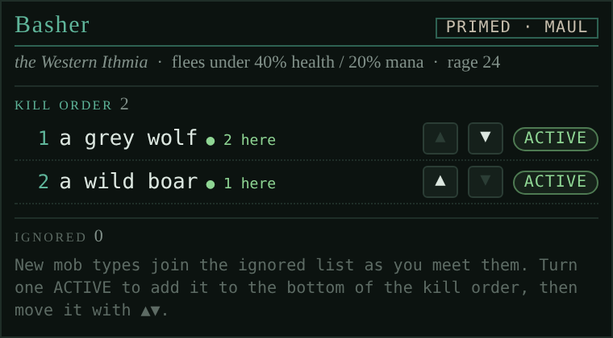
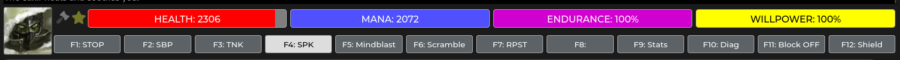

# Basher

*An attended basher: you start each fight, it keeps attacking on balance and equilibrium, fires battlerage, breaks shields and steps back when you're hurt.*

<!-- loom:version basher -->
*This page describes basher 1.0.2.*
<!-- /loom:version -->

## What it is

Basher takes the repetition out of hunting while you stay at the keyboard. Once it's primed, your own first attack starts a **run**: from then on it sends your class's main attack at your target each time balance and equilibrium come back, until the room has no more of what you're hunting. Then it waits, primed, for your next attack.

It is **attended by design**:

- It never starts a fight on its own. You attack first; it carries on.
- It never walks. Its only move is a single step back the way you came when your health or mana runs low.
- It attacks only living mobs in your room, never a player.
- It stands down when someone turns up: another player arriving, a tell to you, or your city channel naming you makes the fight in progress the last one. `BASHER INTERRUPT OFF` turns that off (remembered across loads); enemies still count while the `social-basher` link is on.
- It always loads switched off, and `BASHER STOP` stops it at once.

Along the way it fires battlerage on its own clock, razes a shielded target, asks for a `DIAGNOSE` when a venom confuses you, and keeps a kill order for each area in the **Basher** tab.

**Basher needs the [hunting](hunting.md) package**: it uses hunting's class data for your main attack, battlerage and shieldbreak, and sends nothing without it.

**Curing is not part of Loom.** Use the game's server-side curing (`CURING ON`) or your own curing system while bashing. `BASHER ON` reminds you of this.

## Commands

<!-- loom:commands basher -->
| Command | What it does |
|---|---|
| `BASHER` | status: off, primed or running, and why it isn't attacking |
| `BASHER ON` | prime it: your next attack starts a run of hunting's main attack on tar |
| `BASHER STOP` | stop at once and stand down (the kill switch); BASHER OFF does the same |
| `BASHER END` | end the run in progress at once, staying primed (F1 during a run) |
| `BASHER WIMPY` | show when it flees |
| `BASHER WIMPY HEALTH\|MANA <1-90\|OFF>` | during a run, flee below this health or mana (health 40, mana 20 by default) |
| `BASHER WIMPY DIR <direction\|OFF>` | where to flee when the way back isn't known |
| `BASHER RAZE [ON\|OFF]` | raze a shielded target with your class's shieldbreak (default ON); no word: show it |
| `BASHER RAGE [ON\|OFF]` | battlerage during a run (default ON), in the class's order; no word: show it |
| `BASHER INTERRUPT [ON\|OFF]` | players arriving, tells and your city channel end the run after this fight (default ON, remembered); no word: show it |
| `BASHER DEBUG` | internal state: the run, its target and why, the room |
| **The Basher tab (create a custom tab named Basher) keeps a kill order per area: new mob types join ignored; ACTIVE ones are targeted by priority, then room order. While primed the basher sets your target to the top one whenever that changes; in a run it takes the next after each kill and ends when none are left. With no active types in an area it follows your own target as before.** | |
| **Another player arriving during a run, a tell to you, or a line on your city channel that names you makes the fight in progress the last: it finishes, nothing new starts, the basher waits primed. BASHER INTERRUPT OFF turns all three off. With social, enemies are named as such and still count with interruptions off (loom link social-basher).** | |
| **Loom has no client-side curing: the basher relies on the game's server-side curing (CURING ON) or your own curing system.** | |
| **A shielded target is razed with your class's shieldbreak when you have the rage (BASHER RAZE); dragons Blast it on recovery while their dragonbreath is up; otherwise attacks wait for the shield to fade.** | |
| **While on, "You are confused as to the effects of the venom." sends DIAGNOSE on the next recovery, once per confusion.** | |
| **It attacks only a living mob in the room (never a player), one attack per recovery; with ACTIVE mobs in the area's kill order (Basher tab) it goes on down it while the room has some, without them it finishes the fight it started with; then the run ends (still primed), and sends nothing while pauseTriggers is on. It always loads OFF. Its only move is wimpy's one step back the way you came; then the run is over and it stays primed.** | |
<!-- /loom:commands -->

### Starting and stopping

`BASHER ON` primes it. Attack your target as you normally would (your F1 key, say): that starts the run. The main window says what it's doing: "[basher] running: STAFF on a forest rat until the room runs out of them."

When the room runs out of targets the run ends and the basher stays primed: "run over, still primed. Attack something to start again."

`BASHER STOP` (or `BASHER OFF`) stops everything at once. While a run lasts, **F1 becomes a lit STOP key** that sends `BASHER END`: the run ends at once and the basher stays primed, so your next attack starts a new one. When the run ends, however it ends, F1 goes back to your main attack. `BASHER` alone says whether it's off, primed or running, and if it's waiting, why (no balance, a shield, low health…). Raising your own shield mid-run (`TOUCH SHIELD`, F12) ends the run the same way, since the next attack would drop it.

The basher also switches itself off after 3 attacks in a row that took no balance: something is wrong (no target, a wrong command), and it won't keep sending blindly. It sends nothing at all while `pauseTriggers` is on (`LOOM PAUSE ON`).

### The main attack

The attack is hunting's main attack for your class (`HUNTING MAIN`); for dragons, the F1 attack. It's sent bare when balance and equilibrium return, not through the game's queue, with `@tar` replaced by your target.

### Wimpy

During a run, if your health falls below 40% or your mana below 20%, the basher flees: one step back the way you came, on the next balance and equilibrium. The run is then over and it stays primed.

| Command | What it does |
| --- | --- |
| `BASHER WIMPY HEALTH 50` | flee below 50% health (`OFF` to never flee for health) |
| `BASHER WIMPY MANA OFF` | never flee for mana |
| `BASHER WIMPY DIR south` | where to go when the way back isn't known (you arrived by other means) |

If there's no way back and no direction set, it doesn't move: it ends the run and says so.

### Battlerage

On by default (`BASHER RAGE OFF` leaves it to you). During a run, rage abilities go out on their own clock, since they need no balance, in your class's order:

- by default, the 36-rage hit, then the 14-rage hit, then the 25-rage hit while the 36 stays affordable;
- a class can set its own order with conditions. Magi, for instance, cast Firefall first on a clumsy target, then Squeeze, Windlash and Stormbolt.

`BASHER RAGE` shows the order for your class. The basher notes clumsiness (and a few other afflictions) on mobs as their lines come in, for those conditions.

### Shields

When your target raises a shield ("A nearly invisible magical shield forms around…"), attacks hold. With `BASHER RAZE ON` (the default) the basher razes it with your class's shieldbreak as soon as you have the rage, and tries again after 2.5 seconds if the shield is still up. Dragons Blast it on the next recovery while their dragonbreath is up.

Some classes have no shieldbreak key yet: Alchemist (Caustic), Runewarden (Fragment) and Unnamable (Sunder). For them, and with `BASHER RAZE OFF`, attacks wait for the shield to fade. `BASHER` says which it's doing.

### Venom confusion

While the basher is on, "You are confused as to the effects of the venom." sends `DIAGNOSE` on the next recovery, once per confusion, so your curing can see what to cure.

## The Basher tab: kill order per area

The **Basher** tab lists the mob types of the area you're in, in kill order.

- Every new mob type you meet in an area joins the list **ignored** (marked NEW).
- Click **ACTIVE** to make a type a target; ▲▼ move it up and down the order.
- While primed, the basher keeps your target on the top active mob in the room, using the game's own `settarget`, but only when that changes (a mob arrives, dies or leaves, or you edit the list). A target you pick yourself stays until then. It never attacks on its own.
- In a run, after each kill it takes the next one: active types by the list's order, then the room's order. When none are left, the run ends.

An area with no active types works without the list: the basher follows your own target, finishes that fight, and ends the run (still primed); attack again for the next one, even another mob of the same name.

Named NPCs are best left ignored.

## Setting it up

1. **Import `hunting.nxs` and `basher.nxs`** (see [Getting started](getting-started.md)). Check your class's main attack with `HUNTING MAIN`.
2. **Create the tab.** Add a custom tab named exactly **`Basher`**. If it doesn't appear, reset the UI layout. The training-dummy icon shows after a page reload.
3. **Turn on curing**: `CURING ON` for the game's server-side curing, or your own system.
4. **In a hunting area**, open the Basher tab and switch the mob types you want to ACTIVE, in the order you want them.

## Daily use

1. Walk into a room, `BASHER ON`.
2. Attack the first mob yourself. The basher takes over: attacks, rage, shields, next target.
3. When the room is clear, walk on and attack the next one. The basher is still primed.
4. If someone arrives, it finishes the current fight and waits ("[basher] Ana is here: finishing a forest rat, nothing new after it."). Say hello, then carry on.
5. `BASHER STOP` when you're done, or need your keys back.

## Working with other packages

| Package | How |
| --- | --- |
| hunting | Required: the main attack, battlerage costs and keys, shieldbreak and attack lines all come from hunting's class data (read only). |
| room | Link `basher-room`: Here numbers each living mob in the kill order (filled on your target, outlined in gold on the next), dims the types this area ignores, and shows the basher's state beside the room name (⚔ PRIMED, RUNNING, FLEEING). |
| social | Link `social-basher`: an enemy arriving during a run is named as such when the basher finishes the fight ("[basher] Grulk (enemy) is here: finishing a forest rat, nothing new after it."). |

Each link is on as soon as both packages are installed; `LOOM LINKS` lists them, `LOOM LINK <id> OFF` switches one off.

## Troubleshooting

- **`BASHER ON` but nothing happens.** It waits for your own first attack. `BASHER` says why it isn't attacking.
- **It switched itself off.** Three attacks took no balance in a row: check your target is a mob here and `HUNTING MAIN` is the right attack.
- **It never razes.** Check `BASHER RAZE`, your rage, and whether your class has a shieldbreak key (see above).
- **It stopped after someone arrived.** That's the design: it finishes the fight in progress and waits primed. Attack again to carry on. If you'd rather it kept going (a busy hunting ground, a long tell conversation), `BASHER INTERRUPT OFF`; `BASHER` reminds you while it's off.
- **A mob type isn't targeted.** New types join ignored; switch them ACTIVE in the Basher tab.
