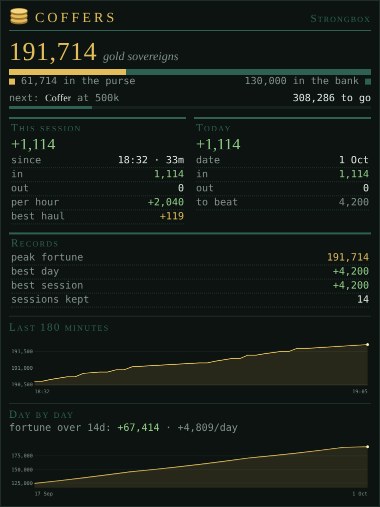

# Coffers

*Gold tracker: fortune, income and spending by session and by day, ranks, records and a goal.*

<!-- loom:version coffers -->
*This page describes coffers 1.4.2.*
<!-- /loom:version -->

## What it is

Coffers keeps your books. It watches the gold in your purse and in the bank, and tells you how much money came in and went out: per play session, per day, and over the last months. It awards wealth ranks as your fortune grows, keeps your records, and can track a goal ("earn 500k").



Coffers only cares about money that enters or leaves your character. Your **fortune** is purse plus bank, so depositing or withdrawing changes nothing. Selling, looting and getting paid count as **in**. Buying, paying and losing gold count as **out**.

Your gold and bank come from the game itself (GMCP), so there is no prompt to configure. Coffers reads them whenever the game reports them, and updates the books once per prompt, whatever your prompt looks like. Its triggers recognise the game lines that name an amount (picking up gold, gifts, shop purchases), to say where the money came from, and note who gives you gold, for the [standings integration](#working-with-other-packages).

What you get:

- **The Coffers tab** has two views. **Wealth** shows your fortune, rank, goal, the open session, today, your records and two graphs. **Accounts** shows where the money came from and where it went: income and spending by source, and the recent moves of money.
- **Notices in the main window** for big gains and losses, new ranks, a reached goal, record days and sessions, and a summary of each session when it closes.
- **The `COFFERS` command** shows all of this as text, prints tables of past sessions and days, lists the recent moves of money, and exports the books as CSV.

## Commands

Everything goes through one command, `COFFERS`. Commands aren't case-sensitive. Amounts can be written in full or short: `50000`, `50k`, `1.5m`. This is the list `COFFERS HELP` prints:

<!-- loom:commands coffers -->
| Command | What it does |
|---|---|
| `COFFERS` | fortune, rank, goal, session, today and records |
| `COFFERS SESSIONS [n] / DAYS [n]` | the books, as tables, with how much of the money is explained |
| `COFFERS LOG [n]` | the last moves of money (20 by default), with their sources |
| `COFFERS LOG UNKNOWN [n]` | the last unexplained moves (5 by default), with the game lines that came with them |
| `COFFERS NEW` | close this session now |
| `COFFERS GAP <5-240>` | minutes without a prompt that close a session |
| `COFFERS GOAL <amount\|OFF>` | earn this much from now (50000, 50k, 1.5m) |
| `COFFERS PROPOSED` | goals other packages proposed, numbered |
| `COFFERS ACCEPT [n]` | add a proposed goal to yours, or make it your goal (the first by default) |
| `COFFERS DISMISS [n]` | drop it; it stays away until its reason clears |
| `COFFERS BIGCOIN <amount\|OFF>` | announce single gains or losses this large |
| `COFFERS RECOUP [<amount>\|DAY\|OFF]` | a single spend this large proposes a goal to earn it back (default DAY: your average gold per day) |
| `COFFERS GRAPH [SESSION\|LONG] [ON\|OFF]` | show or hide the graphs |
| `COFFERS SIZE <40-400>` | graph height (default 105) |
| `COFFERS SPAN SESSION <15-720>` | minutes the session graph covers |
| `COFFERS SPAN LONG <7-365>` | days the day-by-day graph covers |
| `COFFERS CSV [DAYS\|SESSION\|SESSIONS]` | the books as CSV lines |
| `COFFERS WIPE CONFIRM` | burn the whole ledger, moves, goal and proposals too |
| **The tab has two views: Wealth (fortune, goals, graphs) and Accounts (income and spending by source, recent moves).** | |
| `COFFERS RESET / DEBUG` | rebuild helpers and rank table (the books are kept) / internal state |
<!-- /loom:commands -->

### Looking at the books

| Command | What it does |
| --- | --- |
| `COFFERS` | A summary: fortune, how it splits between purse and bank, rank and the next one, the goal, the open session, today, and your records. |
| `COFFERS SESSIONS [n]` | A table of the last *n* closed sessions (default 10, up to 50), plus the open one. Columns: date, start time, length, net, in, out, and gold per hour (for sessions of 10 minutes or more). |
| `COFFERS DAYS [n]` | A table of the last *n* days (default 14, up to 365), newest last: net, in, out and your fortune at the end of the day. |
| `COFFERS CSV [DAYS\|SESSION\|SESSIONS]` | The books as CSV lines, to paste into a spreadsheet. `DAYS` (the default) gives one line per day. `SESSION` gives one line per minute of the session graph. `SESSIONS` gives one line per closed session. |

Example (the figures are made up; the layout is the real one):

```
COFFERS SESSIONS 5
[coffers] last 5 closed session(s), plus the open one:
date   start   length        net        in       out    per hr
14 Oct 19:02   2h 10m    +48,210    61,900    13,690   +22,251
...
15 Oct 18:40      35m    +12,400    12,400         0   +21,257  (open)
```

### Where the money comes from

Every time your fortune changes, Coffers keeps the change as a **move**, with what it was. It knows a move by the game line that came with it: "You pick up 240 gold sovereigns." is *picked up*, "Grulk gives 5,000 gold sovereigns to you." is a *gift*, "You pay 200 sovereigns and receive a sturdy pack." is *shops*. The amounts must add up exactly. Whatever no line explains is **unknown**, so the books are never wrong, only less detailed. The total always comes from the game (GMCP); the lines only name it.

| Command | What it does |
| --- | --- |
| `COFFERS LOG [n]` | The last *n* moves (default 20, up to 200), newest last: time, amount and source. A move can have several sources, and an unknown part ("picked up +500 · shops -200 · unknown -50"). |
| `COFFERS LOG UNKNOWN [n]` | Only the moves with an unknown part (default 5), each with the game lines that came just before it. Copy the line that moved the money into an [issue](https://github.com/neijel-achaea/loom/issues/new/choose) and it can become a source, so the unknown share shrinks over time. |

`COFFERS SESSIONS` and `COFFERS DAYS` have an **explained** column: the share of the money moved that a source names. Sessions and days from before coffers 1.4.0 show `-`.

The sources Coffers knows so far:

| Source | Lines |
| --- | --- |
| picked up | You pick up N gold sovereigns. / You pick up (a small pile…) of golden sovereigns. |
| gifts | X gives N gold sovereigns to you. |
| out of containers | You get N gold sovereigns from (a container). |
| given away | You give N gold sovereigns to X. |
| dropped | You drop N gold sovereigns. |
| shops | You pay N sovereigns and receive (an item). / You purchase N (a commodity) for N gold. |

**Lines with no amount.** Some lines don't say how much ("You pick up a small pile of golden sovereigns."). Such a line takes whatever the lines with amounts leave unexplained on that move, and only if it goes the right way (a pickup only explains money coming in). Otherwise the move stays unknown.

**Gold in containers.** The game counts only the gold you carry, so taking gold out of a pack counts as income and putting it back as spending. *Out of containers* names the first; putting gold away is unknown until its line is added.

### Sessions

A session opens on the first prompt after you log in, or after a long silence. It closes on its own after a stretch of minutes without a prompt (30 by default). When it closes, Coffers prints a summary: how long it lasted, net, in, out, and gold per hour.

| Command | What it does |
| --- | --- |
| `COFFERS NEW` | Closes the open session now. The next prompt opens a fresh one. Useful between a hunt and a shopping trip, if you want to see them apart. |
| `COFFERS GAP <5-240>` | How many minutes without a prompt close a session (default 30). Without a number, shows the current setting. |

### Goal

A goal is an amount to **earn from now on**, counted from your fortune at the moment you set it. Coffers announces once when you reach it, and the tab shows a progress bar. The graphs draw it as a dashed amber line at the fortune you're aiming for ("goal 162,000"), as they do today's aim when no goal is set. A graph only makes room for the line while it lies within three times the range the graph already shows, so a far goal never flattens the curve: it's then a small "goal ↑ 162,000" on the graph's top edge, and the line comes into view as you close in.

| Command | What it does |
| --- | --- |
| `COFFERS GOAL <amount>` | Sets the goal, for example `COFFERS GOAL 250k`. It replaces any goal you had. It needs a reading of your purse first: right after installing, wait for a prompt. |
| `COFFERS GOAL` | Shows the current goal, when it was set, and which package proposed it, if one did. |
| `COFFERS GOAL OFF` | Clears the goal. |

### Goals proposed by other packages

Other packages can suggest a goal through Loom's integrations (see [Working with other packages](#working-with-other-packages)). A proposal never replaces your goal by itself: it waits until you decide.

| Command | What it does |
| --- | --- |
| `COFFERS PROPOSED` | Lists the proposed goals, numbered, with the amount, the reason and the package that proposed it. |
| `COFFERS ACCEPT [n]` | Takes proposal *n* (the first if no number is given). With a goal under way, its amount is **added** to that goal: the start stays, so what you've earned so far counts (goal 10k, 4k earned, accept 5k → goal 15k, 11k to go). With no goal, or one already reached, it becomes a new goal counted from now. |
| `COFFERS DISMISS [n]` | Drops proposal *n*. It stays away until the reason behind it clears; after that, the package may propose it again. |

### Earning back a big spend

Coffers proposes goals of its own too. When a single spend of more than a day's earnings leaves your fortune (a new weapon, sigils, repairs), it proposes earning it back ("coffers proposes a goal: earn 45,000 gold — earn back the 45,000 gold you spent"), through the same `PROPOSED` / `ACCEPT` / `DISMISS` as above. Another big spend before you've recovered adds to the same proposal: it always asks for the whole way back to the fortune you had before the first one. Once your fortune is back there, the proposal goes away by itself. Moving gold to or from the bank never counts.

| Command | What it does |
| --- | --- |
| `COFFERS RECOUP` | Shows the threshold, and the fortune a pending proposal aims to get you back to. |
| `COFFERS RECOUP DAY` | The default: the threshold is your average gold per day, the "/day" figure over the Day by day graph. Until that's known (under a day kept, or your fortune hasn't grown), 20,000. |
| `COFFERS RECOUP <amount>` | A fixed threshold instead (`50000`, `50k`). |
| `COFFERS RECOUP OFF` | No recoup proposals; a pending one is withdrawn. |

### Notices

| Command | What it does |
| --- | --- |
| `COFFERS BIGCOIN <amount\|OFF>` | Announces any single change of at least this much gold: "Ka-ching!" for gains, an orange line for losses. Default 1,000. Without an amount, shows the current setting. |

### The tab's graphs

| Command | What it does |
| --- | --- |
| `COFFERS GRAPH [SESSION\|LONG] [ON\|OFF]` | Shows or hides the graphs. With no words, toggles both. `SESSION` is the minute-by-minute graph, `LONG` the day-by-day one. |
| `COFFERS SIZE <40-400>` | Graph height in pixels (default 105). |
| `COFFERS SPAN SESSION <15-720>` | Minutes the session graph covers (default 180). |
| `COFFERS SPAN LONG <7-365>` | Days the day-by-day graph covers (default 100). Days older than this drop out of the books. |

### The tab's views

The tab opens on **Wealth**: fortune, goal, the Session and Today boxes, records and the graphs. How much of the money is explained is in the Accounts view (and in `COFFERS SESSIONS` and `DAYS`).

**Accounts** shows, for the session, today or the last 7 days (click to switch):

- two donuts, **Income** and **Spending**, one slice per source and unknown always last, in orange. The middle says how much of that side is explained. Each source counts in full, so when money comes and goes on the same prompt (you pick up 500 and pay 200), the donuts show 500 in and 200 out while the Wealth view's in counts the net 300;
- **Recent moves**, newest first. *unknown only* hides the rest. Click an unknown move to see the game lines kept with it.

The tab remembers which view you left it on.

### Maintenance

| Command | What it does |
| --- | --- |
| `COFFERS WIPE CONFIRM` | Burns everything: graphs, days, sessions, records, moves, your goal, pending proposals and dismissals. Only your settings stay. `COFFERS WIPE` alone only asks for confirmation. |
| `COFFERS RESET` | Rebuilds the formatting helpers and the rank table, after editing them, without reloading the page. Your books are untouched. |
| `COFFERS DEBUG` | Shows the raw state: the last gold and bank readings, the open session, how much is stored, and the settings. Useful when reporting a problem. |

## Setting it up

1. **Import `coffers.nxs`** in Nexus's package manager (see [Getting started](getting-started.md)). If you already had it, reimporting keeps your books and settings.
2. **Create the tab.** Add a custom tab named exactly **`Coffers`**. If it doesn't appear, reset the UI layout. The coin-stack icon shows after a page reload.
3. **Get a first reading.** Coffers fills in as soon as the game reports your gold, which it does at login. If the tab says the ledger is empty, type `SCORE` or make a small deposit.

There is nothing else to configure. The defaults suit most players. Books are kept per character, so each of your characters has its own.

If you used the older gold tracker (`gc_*` variables), Coffers moves its data over the first time it loads.

## Daily use

You don't need to do anything for Coffers to work: log in and play. A typical day looks like this:

- **When you log in**, Coffers opens a session and prints your starting fortune: "the books are open: 1,240,500 gold".
- **While you play**, glance at the tab. The big number is your fortune. Below it, a bar shows how it splits between purse (gold) and bank (bronze), how far you are from the next rank, and how far from your goal (or, with no goal and ledger installed, today's aim). The **Session** and **Today** boxes show net, in and out, and the session's gold per hour. **Records** shows your peak fortune, best day and best session. A star appears under Today when you're on track for a record day.
- **Notices** tell you when something worth knowing happens: a large single gain or loss (`BIGCOIN`), a new rank ("*** MILESTONE *** … You are now Opulent"), a goal reached.
- **When you stop**, the session closes after 30 quiet minutes and prints its summary, with a note if it was your most profitable session yet. Use `COFFERS NEW` to close it right away.
- **The next day**, the first prompt closes yesterday's books. If it was your best day so far, Coffers says so.

Some habits that help:

- **Set a goal before a long hunt** (`COFFERS GOAL 200k`), and watch the bar fill. With huntstats installed, Coffers proposes one for you in areas you know.
- **Close the session between activities** (`COFFERS NEW`) to compare a hunting run with a fishing trip in `COFFERS SESSIONS`.
- **Raise `BIGCOIN`** once you're richer, so only changes that matter to you get announced.
- **Export with `COFFERS CSV`** if you want your own charts or a longer history than the tab keeps.

### Ranks

| Fortune from | Rank |
| ---: | --- |
| 0 | Destitute |
| 1,000 | Beggar |
| 2,500 | Wretched |
| 5,000 | Humble |
| 10,000 | Meagre |
| 25,000 | Frugal |
| 50,000 | Ordinary |
| 100,000 | Comforted |
| 250,000 | Prosperous |
| 500,000 | Affluent |
| 1,000,000 | Wealthy |
| 2,500,000 | Opulent |
| 5,000,000 | Magnate |
| 10,000,000 | Rich |
| 25,000,000 | Patrician |
| 50,000,000 | Illustrious |
| 100,000,000 | Magnificent |
| 250,000,000 | Exalted |
| 500,000,000 | Sovereign |
| 1,000,000,000 | Legendary |

The milestone notice comes once per rank, the first time you reach it. Dropping below a rank and climbing back doesn't announce it again.

### What Coffers keeps

| Book | How much |
| --- | --- |
| Session graph | One point per minute, for the last 180 minutes (`SPAN SESSION`). |
| Days | One line per day for the last 100 days (`SPAN LONG`). Days you didn't play are filled in flat. |
| Sessions | The last 50 closed sessions. |
| Records | Peak fortune, best day, best session, highest rank reached. Kept until `WIPE`. |
| Moves | The last 200 changes of fortune with their sources. The newest 40 unknown ones keep up to 15 game lines each. Income and spending by source are kept with each session and day. |
| Gifts | The last 30 times someone gave you gold, in memory only (gone on a page reload). Used only by the `coffers-standings` link. |

## Working with other packages

Coffers works on its own and reads nothing from other packages. Installed alongside others, it takes part in Loom's integrations, which live in the **loom** package. Each one is a link that is on as soon as both its packages are installed; `LOOM LINKS` lists them and `LOOM LINK <id> ON|OFF` switches one.

| Link | With | What it does |
| --- | --- | --- |
| `huntstats-coffers` | huntstats | When you start hunting in an area with hunts on record, proposes a goal 10% over your average hunt there (total gold there ÷ hunts, rounded up to 100): "10% over your average hunt in Annwyn (24,300 gold over 6 hunts)". It's taken back when the hunt ends, filed or left. |
| `coffers-shopping` | shopping | GOAL next to Shopping's total makes the gold the list still needs a goal here at once: added to a goal under way, or a new goal. |
| `coffers-aim-ledger` | [ledger](ledger.md) | A **daily aim**, "Earn 14,000 gold": your net gold a day over the last 7 days (what came in less what went out, as your goal counts it) plus 10%, rounded up to two figures, counted from the day's first prompt. Reaching it gives a lime notice and the item goes until the next day's. The tab shows the same aim under the rank bar, with how much you've made and the share of the way, unless you set a goal of your own or drop the aim from the ledger. No aim while your last 7 days were a loss. |
| `coffers-standings` | standings | When someone gives you 5,000 gold or more at once, standings gets a small friendly dealing with them (+) to review. Gold from someone in your huntstats party is the split being settled, so it's skipped. Each gift is looked at once. |

How proposals behave:

- A proposal shows in the main window ("huntstats proposes a goal: earn 26,800 gold — …"), in the **Proposed goals** section of the tab, and in `COFFERS PROPOSED`.
- Each package has at most one proposal per reason, so a newer one replaces the older quietly. Coffers keeps at most 10.
- **Accepting** adds it to your goal, or makes it your goal when there's none under way. The tab shows where it came from ("· huntstats", or "· huntstats + coffers" when several added to it). From then on it's yours: the hunt ending or the link going off doesn't remove it.
- **Dismissing** keeps it away until its reason clears.
- **Switching a link off** takes back that package's pending proposals.
- **While today's aim is unreached** (the `coffers-aim-ledger` link, above), no new proposals come: the aim already counts every way of making gold, with spending set against it, so a hunt goal or an earn-it-back on top would only push harder. Once it's reached (or dropped from the ledger, or its link is off), they come as before; huntstats' at its next update, so possibly mid-hunt. One already showing stays. Shopping's `GOAL` is your own click, so it always goes through.

## Troubleshooting

- **The tab says the ledger is empty.** No reading of your gold has arrived yet. Type `SCORE` or make a small deposit; `COFFERS DEBUG` shows what has arrived.
- **A deposit showed up as income or spending.** It shouldn't: Coffers waits one prompt after any gold or bank change so both halves of a deposit land first. If you see this, [report it](https://github.com/neijel-achaea/loom/issues/new/choose) with the `COFFERS DEBUG` output.
- **`COFFERS GOAL` says there is nothing to count from.** The goal is measured from your current fortune, which isn't known yet. Wait for the next prompt and try again.
- **Lots of unknown.** Expected at first: only the lines in [Where the money comes from](#where-the-money-comes-from) are known. `COFFERS LOG UNKNOWN` shows the lines that came with each unknown move; send the one that moved the money in an [issue](https://github.com/neijel-achaea/loom/issues/new/choose).
- **A move named the wrong source.** Every money line on the same prompt counts towards the same move, so a line about someone else's gold that happens to match would be counted. Send the lines from `COFFERS LOG UNKNOWN` or `COFFERS LOG`.
- **No goal was proposed when I started hunting.** The area needs at least one filed hunt in huntstats, and the link must be on (`LOOM LINKS`). A proposal you dismissed stays away until that hunt ends.
