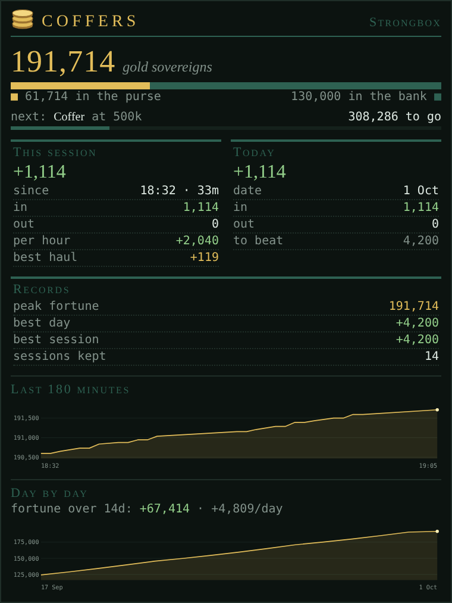

# Coffers

*Gold tracker: fortune, income and spending by session and by day, ranks, records and a goal.*

<!-- loom:version coffers -->
*This page describes coffers 1.0.1.*
<!-- /loom:version -->

## What it is

Coffers keeps your books. It watches the gold in your purse and in the bank, and tells you how much money came in and went out: per play session, per day, and over the last months. It awards wealth ranks as your fortune grows, keeps your records, and can track a goal ("earn 500k").



Coffers only cares about money that enters or leaves your character. Your **fortune** is purse plus bank, so depositing or withdrawing changes nothing. Selling, looting and getting paid count as **in**. Buying, paying and losing gold count as **out**.

Your gold and bank come from the game itself (GMCP), so there is no prompt to configure. Coffers reads them whenever the game reports them, and updates the books once per prompt, whatever your prompt looks like. Its one trigger notes who gives you gold, for the [standings integration](#working-with-other-packages).

What you get:

- **The Coffers tab** shows your fortune, rank, goal, the open session, today, your records and two graphs.
- **Notices in the main window** for big gains and losses, new ranks, a reached goal, record days and sessions, and a summary of each session when it closes.
- **The `COFFERS` command** shows all of this as text, prints tables of past sessions and days, and exports the books as CSV.

## Commands

Everything goes through one command, `COFFERS`. Commands aren't case-sensitive. Amounts can be written in full or short: `50000`, `50k`, `1.5m`. This is the list `COFFERS HELP` prints:

<!-- loom:commands coffers -->
| Command | What it does |
|---|---|
| `COFFERS` | fortune, rank, goal, session, today and records |
| `COFFERS SESSIONS [n] / DAYS [n]` | the books, as tables |
| `COFFERS NEW` | close this session now |
| `COFFERS GAP <5-240>` | minutes without a prompt that close a session |
| `COFFERS GOAL <amount\|OFF>` | earn this much from now (50000, 50k, 1.5m) |
| `COFFERS PROPOSED` | goals other packages proposed, numbered |
| `COFFERS ACCEPT [n]` | add a proposed goal to yours, or make it your goal (the first by default) |
| `COFFERS DISMISS [n]` | drop it; it stays away until its reason clears |
| `COFFERS BIGCOIN <amount\|OFF>` | announce single gains or losses this large |
| `COFFERS GRAPH [SESSION\|LONG] [ON\|OFF]` | show or hide the graphs |
| `COFFERS SIZE <40-400>` | graph height (default 105) |
| `COFFERS SPAN SESSION <15-720>` | minutes the session graph covers |
| `COFFERS SPAN LONG <7-365>` | days the day-by-day graph covers |
| `COFFERS CSV [DAYS\|SESSION\|SESSIONS]` | the books as CSV lines |
| `COFFERS WIPE CONFIRM` | burn the whole ledger, goal and proposals too |
| `COFFERS RESET / DEBUG` | rebuild helpers and rank table (the books are kept) / internal state |
<!-- /loom:commands -->

### Looking at the books

| Command | What it does |
| --- | --- |
| `COFFERS` | A summary: fortune, how it splits between purse and bank, rank and the next one, the goal, the open session, today, and your records. |
| `COFFERS SESSIONS [n]` | A table of the last *n* closed sessions (default 10, up to 50), plus the open one. Columns: date, start time, length, net, in, out, and gold per hour (for sessions of 10 minutes or more). |
| `COFFERS DAYS [n]` | A table of the last *n* days (default 14, up to 365), newest last: net, in, out and your fortune at the end of the day. |
| `COFFERS CSV [DAYS\|SESSION\|SESSIONS]` | The books as CSV lines, to paste into a spreadsheet. `DAYS` (the default) gives one line per day. `SESSION` gives one line per minute of the session graph. `SESSIONS` gives one line per closed session. |

Example (the figures are made up; the layout is the real one):

```
COFFERS SESSIONS 5
[coffers] last 5 closed session(s), plus the open one:
date   start   length        net        in       out    per hr
14 Oct 19:02   2h 10m    +48,210    61,900    13,690   +22,251
...
15 Oct 18:40      35m    +12,400    12,400         0   +21,257  (open)
```

### Sessions

A session opens on the first prompt after you log in, or after a long silence. It closes on its own after a stretch of minutes without a prompt (30 by default). When it closes, Coffers prints a summary: how long it lasted, net, in, out, and gold per hour.

| Command | What it does |
| --- | --- |
| `COFFERS NEW` | Closes the open session now. The next prompt opens a fresh one. Useful between a hunt and a shopping trip, if you want to see them apart. |
| `COFFERS GAP <5-240>` | How many minutes without a prompt close a session (default 30). Without a number, shows the current setting. |

### Goal

A goal is an amount to **earn from now on**, counted from your fortune at the moment you set it. Coffers announces once when you reach it, and the tab shows a progress bar.

| Command | What it does |
| --- | --- |
| `COFFERS GOAL <amount>` | Sets the goal, for example `COFFERS GOAL 250k`. It replaces any goal you had. It needs a reading of your purse first: right after installing, wait for a prompt. |
| `COFFERS GOAL` | Shows the current goal, when it was set, and which package proposed it, if one did. |
| `COFFERS GOAL OFF` | Clears the goal. |

### Goals proposed by other packages

Other packages can suggest a goal through Loom's integrations (see [Working with other packages](#working-with-other-packages)). A proposal never replaces your goal by itself: it waits until you decide.

| Command | What it does |
| --- | --- |
| `COFFERS PROPOSED` | Lists the proposed goals, numbered, with the amount, the reason and the package that proposed it. |
| `COFFERS ACCEPT [n]` | Takes proposal *n* (the first if no number is given). With a goal under way, its amount is **added** to that goal: the start stays, so what you've earned so far counts (goal 10k, 4k earned, accept 5k → goal 15k, 11k to go). With no goal, or one already reached, it becomes a new goal counted from now. |
| `COFFERS DISMISS [n]` | Drops proposal *n*. It stays away until the reason behind it clears; after that, the package may propose it again. |

### Notices

| Command | What it does |
| --- | --- |
| `COFFERS BIGCOIN <amount\|OFF>` | Announces any single change of at least this much gold: "Ka-ching!" for gains, an orange line for losses. Default 1,000. Without an amount, shows the current setting. |

### The tab's graphs

| Command | What it does |
| --- | --- |
| `COFFERS GRAPH [SESSION\|LONG] [ON\|OFF]` | Shows or hides the graphs. With no words, toggles both. `SESSION` is the minute-by-minute graph, `LONG` the day-by-day one. |
| `COFFERS SIZE <40-400>` | Graph height in pixels (default 105). |
| `COFFERS SPAN SESSION <15-720>` | Minutes the session graph covers (default 180). |
| `COFFERS SPAN LONG <7-365>` | Days the day-by-day graph covers (default 100). Days older than this drop out of the books. |

### Maintenance

| Command | What it does |
| --- | --- |
| `COFFERS WIPE CONFIRM` | Burns everything: graphs, days, sessions, records, your goal, pending proposals and dismissals. Only your settings stay. `COFFERS WIPE` alone only asks for confirmation. |
| `COFFERS RESET` | Rebuilds the formatting helpers and the rank table, after editing them, without reloading the page. Your books are untouched. (`COFFERS REBUILD`, its old name, works until Loom 1.1.) |
| `COFFERS DEBUG` | Shows the raw state: the last gold and bank readings, the open session, how much is stored, and the settings. Useful when reporting a problem. |

## Setting it up

1. **Import `coffers.nxs`** in Nexus's package manager (see [Getting started](getting-started.md)). If you already had it, reimporting keeps your books and settings.
2. **The tab.** Importing the package adds a tab named **`Coffers`** by itself. If it doesn't appear, add a custom tab with exactly that name, then reset the UI layout. The coin-stack icon shows after a page reload.
3. **Get a first reading.** Coffers fills in as soon as the game reports your gold, which it does at login. If the tab says the ledger is empty, type `SCORE` or make a small deposit.

There is nothing else to configure. The defaults suit most players. Books are kept per character, so each of your characters has its own.

If you used the older gold tracker (`gc_*` variables), Coffers moves its data over the first time it loads.

## Daily use

You don't need to do anything for Coffers to work: log in and play. A typical day looks like this:

- **When you log in**, Coffers opens a session and prints your starting fortune: "the books are open: 1,240,500 gold".
- **While you play**, glance at the tab. The big number is your fortune. Below it, a bar shows how it splits between purse (gold) and bank (bronze), how far you are from the next rank, and how far from your goal. The **Session** and **Today** boxes show net, in and out, and the session's gold per hour. **Records** shows your peak fortune, best day and best session. A star appears under Today when you're on track for a record day.
- **Notices** tell you when something worth knowing happens: a large single gain or loss (`BIGCOIN`), a new rank ("*** MILESTONE *** … Welcome to the Vault"), a goal reached.
- **When you stop**, the session closes after 30 quiet minutes and prints its summary, with a note if it was your most profitable session yet. Use `COFFERS NEW` to close it right away.
- **The next day**, the first prompt closes yesterday's books. If it was your best day so far, Coffers says so.

Some habits that help:

- **Set a goal before a long hunt** (`COFFERS GOAL 200k`), and watch the bar fill. With huntstats installed, Coffers proposes one for you in areas you know.
- **Close the session between activities** (`COFFERS NEW`) to compare a hunting run with a fishing trip in `COFFERS SESSIONS`.
- **Raise `BIGCOIN`** once you're richer, so only changes that matter to you get announced.
- **Export with `COFFERS CSV`** if you want your own charts or a longer history than the tab keeps.

### Ranks

| Fortune from | Rank |
| ---: | --- |
| 0 | Empty Pockets |
| 10,000 | Coin Purse |
| 100,000 | Strongbox |
| 500,000 | Coffer |
| 1,000,000 | Counting House |
| 2,500,000 | Vault |
| 5,000,000 | Treasury |
| 10,000,000 | Hoard |
| 50,000,000 | Dragon's Hoard |
| 250,000,000 | Mountain of Gold |

The milestone notice comes once per rank, the first time you reach it. Dropping below a rank and climbing back doesn't announce it again.

### What Coffers keeps

| Book | How much |
| --- | --- |
| Session graph | One point per minute, for the last 180 minutes (`SPAN SESSION`). |
| Days | One line per day for the last 100 days (`SPAN LONG`). Days you didn't play are filled in flat. |
| Sessions | The last 50 closed sessions. |
| Records | Peak fortune, best day, best session, highest rank reached. Kept until `WIPE`. |
| Gifts | The last 30 times someone gave you gold, in memory only (gone on a page reload). Used only by the `coffers-standings` link. |

## Working with other packages

Coffers works on its own and reads nothing from other packages. Installed alongside others, it takes part in Loom's integrations, which live in the **loom** package. Each one is a link that is on as soon as both its packages are installed; `LOOM LINKS` lists them and `LOOM LINK <id> ON|OFF` switches one.

| Link | With | What it does |
| --- | --- | --- |
| `huntstats-coffers` | huntstats | When you start hunting in an area with hunts on record, proposes a goal 10% over your average hunt there (total gold there ÷ hunts, rounded up to 100): "10% over your average hunt in Annwyn (24,300 gold over 6 hunts)". It's taken back when the hunt ends, filed or left. |
| `coffers-standings` | standings | When someone gives you 5,000 gold or more at once, standings gets a small friendly dealing with them (+) to review. Gold from someone in your huntstats party is the split being settled, so it's skipped. Each gift is looked at once. |

How proposals behave:

- A proposal shows in the main window ("huntstats proposes a goal: earn 26,800 gold — …"), in the **Proposed goals** section of the tab, and in `COFFERS PROPOSED`.
- Each package has at most one proposal per reason, so a newer one replaces the older quietly. Coffers keeps at most 10.
- **Accepting** adds it to your goal, or makes it your goal when there's none under way. The tab shows where it came from ("· huntstats", or "· huntstats + coffers" when several added to it). From then on it's yours: the hunt ending or the link going off doesn't remove it.
- **Dismissing** keeps it away until its reason clears.
- **Switching a link off** takes back that package's pending proposals.

## Troubleshooting

- **The tab says the ledger is empty.** No reading of your gold has arrived yet. Type `SCORE` or make a small deposit; `COFFERS DEBUG` shows what has arrived.
- **A deposit showed up as income or spending.** It shouldn't: Coffers waits one prompt after any gold or bank change so both halves of a deposit land first. If you see this, [report it](https://github.com/neijel-achaea/loom/issues/new/choose) with the `COFFERS DEBUG` output.
- **`COFFERS GOAL` says there is nothing to count from.** The goal is measured from your current fortune, which isn't known yet. Wait for the next prompt and try again.
- **No goal was proposed when I started hunting.** The area needs at least one filed hunt in huntstats, and the link must be on (`LOOM LINKS`). A proposal you dismissed stays away until that hunt ends.
