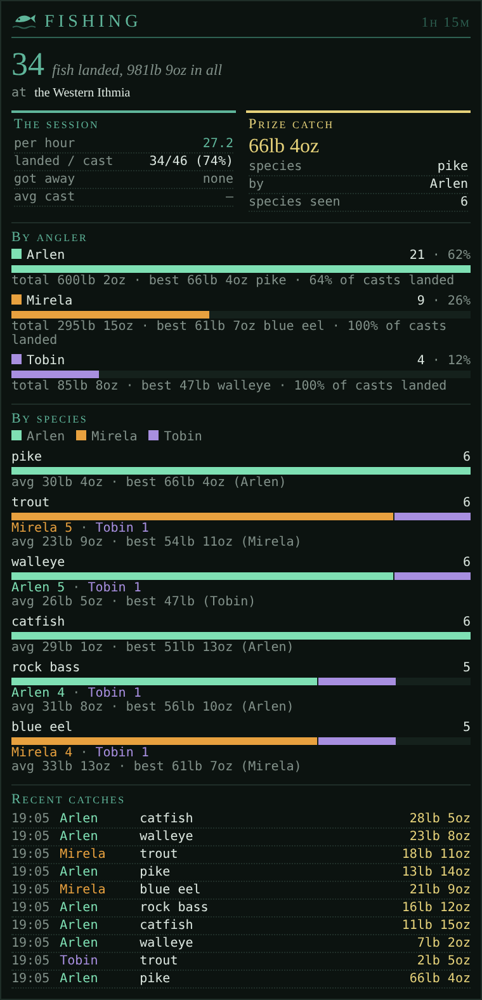
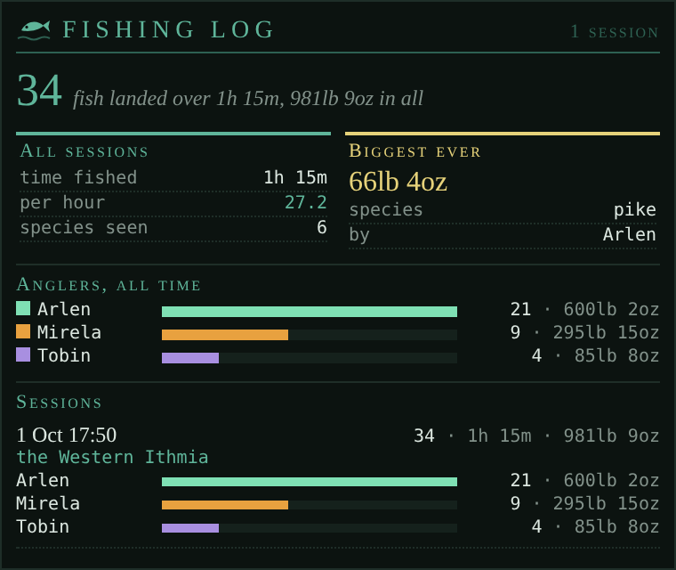

# FishingStats

*Casts, hooks and catches for you and everyone fishing around you, per angler and per species, with a log of past sessions and a flag on record catches.*

<!-- loom:version fishingstats -->
*This page describes fishingstats 1.0.0.*
<!-- /loom:version -->

## What it is

FishingStats watches the fishing going on around you (yours and everyone else's) and keeps the score in two tabs:

- **fishingstats**, the session under way: each angler with their catch count and a bar in their colour, their casts, hooks and landing rate, their biggest fish; and each species caught, its bar split by angler so you can see who's catching what.
- **fishinglog**, the sessions you've fished before, and all-time totals.

A **session** files itself into the log after 90 minutes without a cast or catch (`FISHINGSTATS GAP` to change), so a day at the pier becomes one entry without you doing anything. A session where nothing was landed is thrown away rather than logged.

**Record catches.** Once you've loaded the year's rankings (`RANKINGS FISHING`), a catch that beats this year's ranking for its species is flagged in the main window: "[fishingstats] Ana's blue eel at 6lb 3oz beats this year's ranking of 5lb 14oz by…".

Weights are kept in pounds and ounces as the game reports them; the area comes from the game (GMCP), and so does your own name.

## Commands

<!-- loom:commands fishingstats -->
| Command | What it does |
|---|---|
| `FISHINGSTATS` | this session by angler, and the settings |
| `FISHINGSTATS END` | file this session to the log and start a new one |
| `FISHINGSTATS DISCARD [CONFIRM]` | throw this session away without filing it |
| `FISHINGSTATS LOG [WIPE [CONFIRM]]` | redraw the fishinglog tab / clear the log |
| `FISHINGSTATS GAP <5-1440>` | minutes idle before a session files itself |
| `FISHINGSTATS AREA [<name>\|AUTO\|RESET]` | pin the area / follow the game / forget this session's |
| `FISHINGSTATS YEAR <n>` | the Achaean year (normally read from RANKINGS FISHING) |
| `FISHINGSTATS ME [<name>\|AUTO]` | your angler name (normally your character's) |
| `FISHINGSTATS COLOUR <name> <#rrggbb\|RESET>` | an angler's colour in the tabs |
| `FISHINGSTATS ADD <angler> <lb> [oz] <species>` | record a catch by hand |
| `FISHINGSTATS CSV` | this session as CSV lines |
| `FISHINGSTATS LEARN [ON\|OFF\|SHOW\|CLEAR]` | capture raw lines to fix a missed catch message |
| `FISHINGSTATS DEMO / DEBUG` | sample data in the tab / internal state |
| **Type RANKINGS FISHING once a year so new records are flagged.** | |
<!-- /loom:commands -->

### Sessions

`FISHINGSTATS` sums up the session by angler. `FISHINGSTATS END` files it now and starts a new one; `FISHINGSTATS DISCARD CONFIRM` throws it away. `FISHINGSTATS CSV` prints it as CSV lines.

### Area, year and names

The session's area follows the game. `FISHINGSTATS AREA Western Ithmia` pins it (useful at a spot whose area name isn't what you'd call it); `AUTO` follows the game again.

The Achaean year is read from `RANKINGS FISHING`; `FISHINGSTATS YEAR 1016` sets it by hand. Your angler name is your character's; `FISHINGSTATS ME` changes it.

Each angler gets a colour, chosen so neighbours differ in both hue and lightness. `FISHINGSTATS COLOUR Ana #88ccff` sets one; `RESET` goes back to the automatic colour.

### Fixing a missed catch

If a catch wasn't counted, `FISHINGSTATS ADD Ana 4 7 blue eel` records it by hand (4 lb 7 oz).

If catches are missed regularly, the game is probably wording them in a way FishingStats doesn't know yet. `FISHINGSTATS LEARN ON` captures the raw lines while you fish; `LEARN SHOW` prints them; send them with a [bug report](https://github.com/neijel-achaea/loom/issues/new/choose). `LEARN OFF` stops capturing, `LEARN CLEAR` forgets what was captured.

## Setting it up

1. **Import `fishingstats.nxs`** (see [Getting started](getting-started.md)).
2. **Create the tabs.** Add two custom tabs named exactly **`fishingstats`** and **`fishinglog`** (lower case). If they don't appear, reset the UI layout. Their icons show after a page reload.
3. **Type `RANKINGS FISHING` once**, and again each new Achaean year, so record catches are flagged.

`FISHINGSTATS DEMO` fills the tab with sample data, to see what it looks like before your first cast.

If you used the older fishing stats (`fsh_*` variables), the data moves over the first time it loads.

## Daily use

Fish as usual, with or without the **fishing** package. Glance at the fishingstats tab to compare landing rates with the anglers beside you, and at the log to see how a spot has done over time.

## Working with other packages

FishingStats reads nothing from other packages and no other package reads it. The **fishing** package does the casting and reeling; FishingStats only counts, for you and everyone around you.

## Troubleshooting

- **A catch wasn't counted.** Add it by hand with `FISHINGSTATS ADD`, and capture the line with `LEARN` (see above).
- **No record flags.** Type `RANKINGS FISHING` so this year's rankings are loaded.
- **A session filed too early or too late.** Change `FISHINGSTATS GAP` (5 to 1440 minutes).
- **`FISHINGSTATS LOG WIPE CONFIRM`** clears the log. There's no undo.
