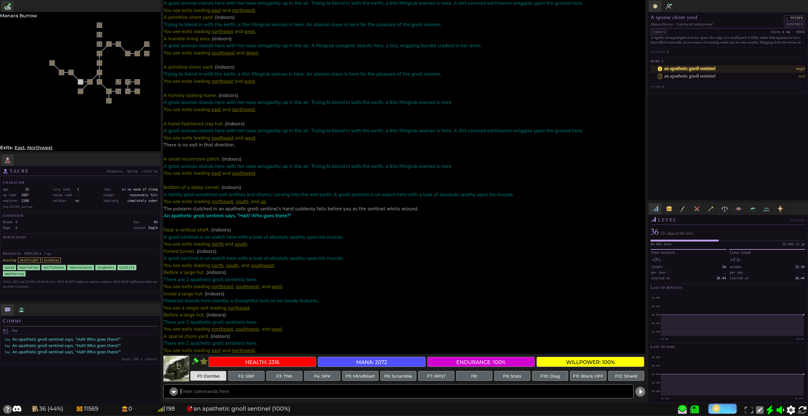
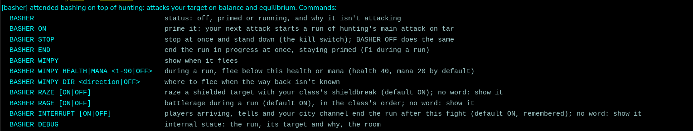
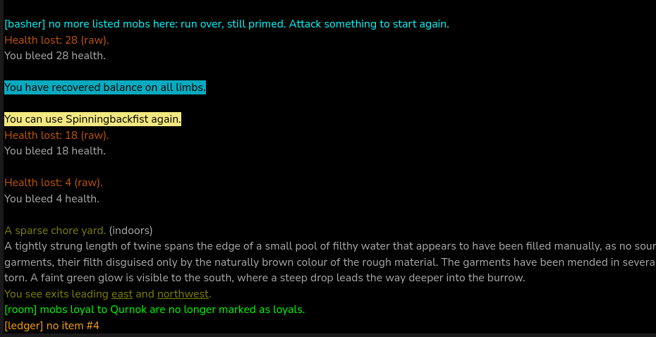

# Getting started

Loom is a set of packages for Achaea's web client, [Nexus](https://play.achaea.com). Each package does one job (a gold tracker, a room tab, a defence manager, an attended basher…) and works on its own. Installed together, they feed each other: names take your standings' colours, the ledger reminds you to harvest, huntstats knows how hard an area hits you.

You pick the packages you want. Nothing needs all of them.

Some packages act for you once you've started them (the basher, fishing, harvesting), and stop when that one thing is done: Loom is reflexes, not a bot. Before using them, read **[Safety and fair play](safety.md)**: the game has firm rules on automation, and the page explains where Loom stops and why.

## 1. Download

Get the packages from the [releases page](https://github.com/neijel-achaea/loom/releases). The latest release has a zip, `loom-X.Y.Z.zip`, with one `.nxs` file per package. Unzip it anywhere.

A single package can also be downloaded on its own from the [`dist/`](https://github.com/neijel-achaea/loom/tree/main/dist) folder: open the file and use the download button. `dist/` always holds the newest build, which may be ahead of the latest release.

## 2. Import

In Nexus, open **Settings → Reflexes**, choose **Import**, and pick a `.nxs` file. Repeat for each package you want.

Start with **`loom.nxs`**. It isn't required, but it gives you the `LOOM` command, update checks, and every integration between packages. Without it, each package still works alone.

Check each package's page before importing it: a few need another package (the basher needs **hunting**, for your class's attacks).

Your data (gold history, ledger items, standings, settings) is kept in Nexus variables, separately from the packages, and per character. Reimporting a newer version of a package keeps it.

## 3. Create the tabs

Some packages draw their own tab. Nexus needs the tab to exist first: add a **custom tab** with **exactly** the name below (capitals included).

| Package | Tab name |
| --- | --- |
| basher | `Basher` |
| coffers | `Coffers` |
| comms | `Comms` |
| dmgchart | `DmgChart` |
| fishingstats | `fishingstats` and `fishinglog` |
| huntstats | `Stats` |
| ledger | `Ledger` |
| levelgraph | `Level` |
| partycomms | `Party` |
| room | `Here` |
| self | `Self` |
| social | `Online` |
| standings | `Standings` |
| talpieces | `Talismans` |

If a tab doesn't appear, reset the UI layout. Tab icons show after a page reload.

Room's tab is called **Here**, not Room, because Nexus already has a Room tab of its own.

How it can look once the tabs are placed (here: Self and Comms on the left, Here on the right above Level, with the other Loom tabs in the strip below it; arrange yours as you like):

## 4. First commands

Every package answers to one word, its name in capitals, and lists its commands with `HELP`: `COFFERS HELP`, `ROOM HELP`, `DEFCON HELP`.

Loom's notices start with the package's name in brackets, and their colour says what kind they are: **cyan** for information (a status, HELP, a list), **lime** when something was done or saved, **orange** when something went wrong or needs a look (an unknown command, a warning). Red is kept for security's theft alarm.

Loom's own commands:

<!-- loom:commands loom -->
| Command | What it does |
|---|---|
| `LOOM` | packages loaded, with version and command |
| `LOOM UPDATES` | packages here that are older than on GitHub |
| `LOOM UPDATES AUTO ON\|OFF` | the same check once at login, silent when all is current |
| `LOOM PAUSE ON\|OFF` | stop packages sending commands (interruptible actions) |
| `LOOM DEBUG ON\|OFF` | debug notices |
| `LOOM ROOM` | current room id, name, area and environment |
| `LOOM LINKS` | integrations between packages, on, off or waiting for a package |
| `LOOM LINK <id> ON\|OFF` | switch one integration |
| `LOOM THEME` | the tabs' colour theme and the cities to choose from |
| `LOOM THEME <city>\|AUTO\|OFF` | one city's colours, your own city's (default) or each tab's own |
| `LOOM PERF [seconds]` | measure what each package costs while you play (default 60 s), then report |
| `LOOM PERF STOP` | end the sample now and report |
| `LOOM PERF DATA` | how much saved data each package keeps |
<!-- /loom:commands -->

Type `LOOM` first: it lists the packages it can see, with their versions.

## 5. Integrations

When two packages that can work together are both installed, their integration (a **link**) switches on by itself. `LOOM LINKS` lists every link, on, off, or waiting for a package you don't have. `LOOM LINK <id> OFF` switches one off and takes back whatever it added (a ledger reminder, a proposed goal, a suggested standing).

Integrations only suggest. Ledger reminders can be marked done or dropped, coffers goals wait for `COFFERS ACCEPT`, standings dealings wait for `STANDINGS OK`.

Each package's page has a "Working with other packages" section listing its links, and the [loom page](loom.md#integrations) lists them all.

## 6. Keeping up to date

`LOOM UPDATES` compares your packages with the newest builds on GitHub and lists the ones that are behind. It also runs once at login, silently when everything is current (`LOOM UPDATES AUTO OFF` stops that). To update, import the newer `.nxs` over the old one: no restart needed, your data and settings carry over.

## 7. Stopping everything

`LOOM PAUSE ON` stops the packages from sending commands to the game; `LOOM PAUSE OFF` lets them carry on. The basher has its own kill switch, `BASHER STOP`. Stop them whenever you step away from the keyboard.

## Something wrong?

[Troubleshooting](troubleshooting.md) covers the common problems. For anything else, use the [bug report form](https://github.com/neijel-achaea/loom/issues/new/choose): which package and version (`LOOM` shows it), what you did, what you expected, and the lines the game showed. Ideas are welcome there too.

## The packages

See the [index](README.md) for every package and its page.
