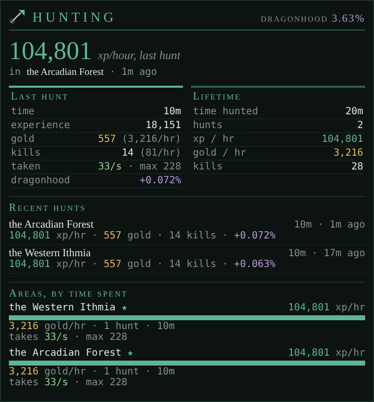

# Huntstats

*Your hunting records, area by area: experience, gold and kills an hour, how hard each area hits, where to go next, and the party's gold split.*

<!-- loom:version huntstats -->
*This page describes huntstats 1.0.0.*
<!-- /loom:version -->

## What it is

Huntstats times your hunts and keeps the books on every area you hunt in. A **hunt** starts with the first experience you gain in an area and is **filed** when you leave the area: its experience, gold, kills and length are added to that area's record, and a line in the main window sums it up:



```
[huntstats] Annwyn: 412,800 xp (198,144/hr), 24,300 gold, 61 kills, 2h 05m, took 38/s (max hit 1,240)
```

From those records it tells you which areas pay best, how close you are to the next level and to Dragonhood (level 99), and where to hunt next. When you hunt with others, it works out the gold split.

What you get:

- **The Stats tab**: the hunt under way (or the last one), your next level and Dragonhood, and every area with its rates.
- **A notice for each filed hunt**, and the party's split when there was a party.
- **The `HUNTSTATS` command** for the hunt under way, the area table, the log and suggestions.

Your area and level come from the game (GMCP); experience, gold and kills from the game's lines ("You have gained…", "You pick up… gold sovereigns", "You have slain…").

## Commands

<!-- loom:commands huntstats -->
| Command | What it does |
|---|---|
| `HUNTSTATS` | the hunt under way: rates, next level, Dragonhood |
| `HUNTSTATS AREAS` | every area hunted, by total time, with its rates and the damage it deals |
| `HUNTSTATS TANK [percent]` | how much of your max health a second you can heal back (default 3); colours the damage areas deal |
| `HUNTSTATS LOG` | the last five hunts |
| `HUNTSTATS SUGGEST` | the ten best areas to hunt next, by xp/hr, gold/hr and how long since you went |
| `HUNTSTATS SUGGEST WEIGHTS <x> <g> <v>` | how much xp, gold and variety count (default 70 25 5) |
| `HUNTSTATS FLUSH` | file the hunt under way now |
| `HUNTSTATS PARTY` | who you're hunting with |
| `HUNTSTATS PARTY ADD <names>` | add people to the party (kept until removed) |
| `HUNTSTATS PARTY DEL <names>` | remove people from the party |
| `HUNTSTATS PARTY CLEAR` | back to hunting alone |
| `HUNTSTATS SPLIT` | the party's gold so far and the transfers that even it out |
| `HUNTSTATS SPLIT REPORT` | send the split to party tell now, one line per person |
| `HUNTSTATS SPLIT TELL ON\|OFF` | also send it to party tell when a party hunt ends (default OFF) |
| `HUNTSTATS WIPE CONFIRM` | clear all area records and the log |
| `HUNTSTATS DEBUG` | internal state |
| **A hunt is filed when you leave its area, and needs a minute or more of experience. A party hunt's gold split is shown then.** | |
<!-- /loom:commands -->

### The hunt under way

`HUNTSTATS` shows it: time, experience, gold and kills with their rates per hour, the experience left to the next level and how long that takes at this rate, and your Dragonhood (the share of the experience to level 99 you've earned) with an estimate of when you'll get there.

A hunt is filed when you leave its area, and only if it earned experience over a minute or more (so walking through an area files nothing). `HUNTSTATS FLUSH` files it now, for instance before switching to another activity in the same area. Loom's `QUIT` files it on the way out.

If the page reloads or you disconnect mid-hunt, Huntstats picks the hunt up again when you're back, as long as it was less than 10 minutes ago; after longer, the old hunt is filed as it stood.

### Areas and the log

`HUNTSTATS AREAS` lists every area you've hunted, by total time: experience, gold and kills an hour, and (with dmgchart) the damage it deals. `HUNTSTATS LOG` shows the last five hunts.

### Where to hunt next

`HUNTSTATS SUGGEST` ranks your areas for your next hunt. Each area scores on:

- **xp/hr** against your best area,
- **gold/hr** against your best area,
- **variety**: a bonus that grows to full over 7 days since you last hunted there.

The weights are 70 xp, 25 gold, 5 variety by default. `HUNTSTATS SUGGEST WEIGHTS 40 50 10` favours gold and a change of scenery; any three numbers, not all zero. Rates per hour hold whatever your level, so old records stay useful.

### Damage taken

With **dmgchart** installed, each hunt also records the damage you took per second of combat and the biggest single hit, and each area keeps them. They're coloured against how much health a second you can heal back, as a share of your max health:

| Colour | Meaning |
| --- | --- |
| green | under half of what you can heal |
| yellow | up to what you can heal |
| red | more than you can heal: you'll lose ground |

`HUNTSTATS TANK 3` sets that share (3% of your max health a second by default, about what health elixirs alone give). Raise it if your curing or class heals more.

### Hunting with a party

Huntstats doesn't guess who you hunt with: you tell it. `HUNTSTATS PARTY ADD Ana Bor` adds people; the party stays until you remove them (`PARTY DEL`) or `PARTY CLEAR`, across hunts and reloads. Each hunt starts with the party as it stands, and anyone added during a hunt joins it.

**The gold split.** During a party hunt, Huntstats follows the gold in each person's hands: picked up, dropped, given to someone in the party. Gold leaving to someone outside the party leaves the pot, and someone who put in their own gold is paid back. `HUNTSTATS SPLIT` shows each person's share so far and the fewest transfers that even it out (largest debtor pays largest creditor first). When the hunt is filed, the split is shown again. `HUNTSTATS SPLIT REPORT` sends it to party tell, one line per person, and `HUNTSTATS SPLIT TELL ON` sends it there on its own when a party hunt ends.

One limit: when two other people pass gold between themselves, the game doesn't say how much ("gives some gold sovereigns"). Huntstats notes it, but can't count it.

## Setting it up

1. **Import `huntstats.nxs`** (see [Getting started](getting-started.md)).
2. **Create the tab.** Add a custom tab named exactly **`Stats`**. If it doesn't appear, reset the UI layout. The arrowhead icon shows after a page reload.
3. **Hunt.** The first experience you gain starts the first hunt. Type `SCORE` once if you want the precise level percentage straight away; GMCP gives it in whole percent.

If you used the older huntstats (`hs_*` variables), its records move over the first time it loads.

## Daily use

- **Before heading out**, `HUNTSTATS SUGGEST` for ideas, or look at the areas list in the Stats tab: each bar is an area's xp/hr against your best.
- **While you hunt**, the tab's top section shows the hunt under way with its rates; watch the damage line for an area that's hitting harder than you heal.
- **With a party**, `HUNTSTATS PARTY ADD` everyone at the start, and `HUNTSTATS SPLIT REPORT` before you split up.
- **When you leave**, the hunt files itself and the notice tells you how it went.

## Working with other packages

Huntstats works on its own. **hunting**'s F9 key shows the hunt under way when Huntstats is installed, and **loom**'s `QUIT` files the hunt. Loom's integrations do more; each is a link, on as soon as both packages are installed; `LOOM LINKS` lists them, `LOOM LINK <id> OFF` switches one off.

| Link | With | What it does |
| --- | --- | --- |
| `dmgchart-huntstats` | dmgchart | The damage you took per combat second and the biggest hit, per hunt and per area, in the filing notice, `HUNTSTATS AREAS`, `LOG` and the Stats tab. Nothing is recorded for a hunt the page reloaded in the middle of. |
| `huntstats-coffers` | coffers | When you start hunting in an area with hunts on record, Coffers proposes a gold goal 10% over your average hunt there. It's taken back when the hunt is filed or you leave. |
| `huntstats-standings` | standings | A filed hunt of 30 minutes or more with a party suggests a small friendly dealing (+) with each member, to review in Standings ("hunted together in Annwyn for 45m"). |
| `coffers-standings` | coffers, standings | Gold from someone in your party is the split being settled, so it isn't treated as a gift. |

## Troubleshooting

- **A hunt wasn't filed.** It needs experience over at least a minute. A short visit files nothing.
- **The rates look too high for a short hunt.** Rates per hour from a few minutes' hunting are scaled to an hour; they settle as an area's record grows.
- **No damage figures.** dmgchart must be installed and the `dmgchart-huntstats` link on. A hunt that the page reloaded in the middle of has no damage figures.
- **The damage colour is missing.** It needs your max health, which arrives with your vitals; it shows after the next prompt.
- **`HUNTSTATS WIPE CONFIRM`** clears every area record and the log. There's no undo.
