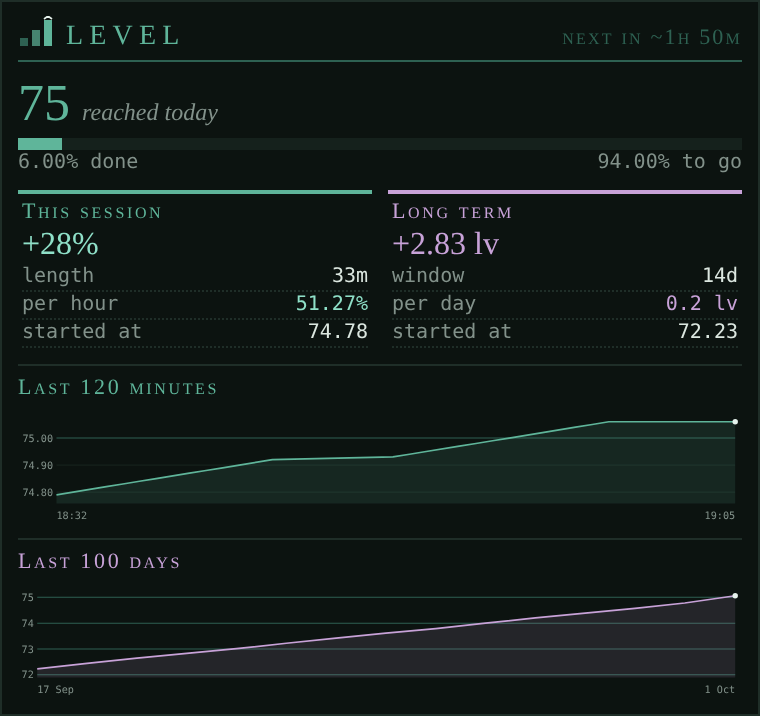

# LevelGraph

*Your progress through the levels as graphs, per minute and per day, with rates and the time to your next level.*

<!-- loom:version levelgraph -->
*This page describes levelgraph 1.0.1.*
<!-- /loom:version -->

## What it is

LevelGraph follows your level and how far you are into it, and draws them in the **Level** tab:

- **Your level** as the big figure, with how far into it you are.
- **This session**: how much of a level you've gained since the session started, per hour ("+38% = 19%/hr"), and how long the next level will take at that rate. A session starts with your first prompt, and ends when you start a new one with `LEVELGRAPH NEW` or after 30 minutes without a prompt (`LEVELGRAPH GAP`), as in Coffers.
- **The long term**: levels gained per day.
- **A minute-by-minute graph** over the last 2 hours. Its span is separate from the session: a 3-hour session still counts from its start. A red skull and a dashed line mark each time you died; hover it to see who killed you and when.
- **A long-term graph**: one point per day over the last 100 days.

It reads your level from the game (GMCP) once per prompt, whatever your prompt looks like, so there's nothing to set up. When the game's character stats carry the precise figure ("Level: 54 (23.45%)"), it uses that rather than the whole percent.

## Commands

<!-- loom:commands levelgraph -->
| Command | What it does |
|---|---|
| `LEVELGRAPH` | level, session and long-term rates, time to the next level |
| `LEVELGRAPH MARK` | record a sample now |
| `LEVELGRAPH NEW` | close this session and start a new one now |
| `LEVELGRAPH GAP <5-240>` | minutes without a prompt that close a session (default 30) |
| `LEVELGRAPH GRAPH [SESSION\|LONG] [ON\|OFF]` | show or hide the graphs in the Level tab |
| `LEVELGRAPH SIZE <40-400>` | graph height (default 105) |
| `LEVELGRAPH SPAN SESSION <15-720>` | minutes the minute-by-minute graph covers (the session's figures don't depend on it) |
| `LEVELGRAPH SPAN LONG <7-365>` | days the long-term graph covers |
| `LEVELGRAPH CSV [SESSION\|LONG]` | a buffer as CSV lines |
| `LEVELGRAPH WIPE CONFIRM` | clear both buffers and the session |
| `LEVELGRAPH DEBUG` | internal state |
<!-- /loom:commands -->

`LEVELGRAPH` sums it up in the main window. `LEVELGRAPH MARK` records a point now, without waiting for the next minute. `LEVELGRAPH NEW` closes the session and starts a new one at your current level, for example when you move to another area and want its rate on its own; `LEVELGRAPH GAP 60` lets a session survive longer breaks (5–240 minutes, default 30).

The graphs can be hidden (`LEVELGRAPH GRAPH LONG OFF` keeps only the session graph), made taller or shorter (`LEVELGRAPH SIZE 150`), and set to cover more or less time:

| Command | Default | Range |
| --- | --- | --- |
| `LEVELGRAPH SPAN SESSION <minutes>` | 120 | 15–720 |
| `LEVELGRAPH SPAN LONG <days>` | 100 | 7–365 |

Points older than the span drop out of the buffer. `LEVELGRAPH CSV SESSION` or `CSV LONG` prints a buffer as CSV lines (date and time, level, percent, progress) to paste into a spreadsheet, if you want a longer record than the tab keeps.

## Setting it up

1. **Import `levelgraph.nxs`** (see [Getting started](getting-started.md)).
2. **Create the tab.** Add a custom tab named exactly **`Level`**. If it doesn't appear, reset the UI layout. The stair icon shows after a page reload.
3. **Play.** The first prompt gives the first point.

If you used the older level graph (`lvl_*` variables), its history moves over the first time it loads.

## Daily use

Start a session with `LEVELGRAPH NEW` when you start hunting, and glance at the graph while you do: a steep line is a good area. The long-term graph shows your pace over weeks, and the time to next level tells you whether one more hour gets you there.

## Working with other packages

LevelGraph reads nothing from other packages and no other package reads it. For experience per area and per hunt, see [huntstats](huntstats.md).

## Troubleshooting

- **The graph is flat at the start.** It needs a few minutes of points to draw a slope.
- **A death isn't marked.** The skull comes from the line "You have been slain by …". If your death reads differently, report the line.
- **`LEVELGRAPH WIPE CONFIRM`** clears both graphs and the deaths marked. There's no undo.
