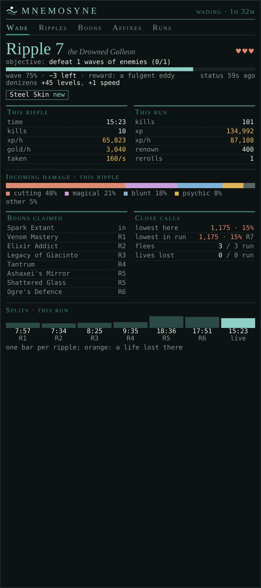

# Ripples

*The Mnemosyne's wades, ripple by ripple: places, boons, affixes and runs, in the Ripples tab.*

<!-- loom:version ripples -->
*This page describes ripples 0.1.0.*
<!-- /loom:version -->

## What it is

Ripples follows your wades in the Mnemosyne, the roguelike trials beside the whirlpool in ancient Seleucar. It needs nothing from you: it notices the wade starting, each ripple's countdown and `GO!`, each boon screen and claim, and the way out, and keeps a record of every run.

The **Ripples** tab has five views:

- **Wade**, the run under way: the ripple and its place, your lives, the objective and wave progress with a guess at the denizens left, the affixes (each with how often you've survived it), this ripple's and this run's time, kills, xp and gold an hour and damage taken, the damage by type, the boons you've claimed beside your **close calls** (lowest health in this ripple and in the run, the basher's flees, lives lost), and each ripple's time against your best run.
- **Ripples**: the run ripple by ripple (with the lowest health and the basher's flees in each); every place you've met (click one to rename it) (depths, how often you came out without losing a life, xp an hour); and a chart of time and damage taken by depth.
- **Boons**: what's on offer now, with what each option did for you before; every boon offered, taken and passed, and the median depth of runs that held it; how much of the codex you've met.
- **Affixes**: each affix seen, from what depth, how often you survived it, and how that compares with every other ripple at the same depths, so a deep affix isn't blamed for the depth.
- **Runs**: your deepest ripple, totals, renown, how far runs get (the share that reached each ripple), and the list of runs and how they ended.

Damage taken a second is coloured as the Stats tab colours it: green under half of what you heal back, yellow up to it, red above (`HUNTSTATS TANK` when huntstats is installed, else 3% of your max health a second).

The denizens left are a guess: the kills by the last `WADE STATUS`, divided by its wave progress, less the kills since.

Wide tables scroll sideways when the tab is narrow, and keep their place when the tab redraws.

When a boon screen comes up, the main window also gets a line per option: how many times you took it out of how many it was offered, or that it's new.

### What it asks the game

Two things the game only says when asked:

- **`WADE STATUS`** gives the lives, wave progress, objective and the affixes (affixes aren't printed anywhere else). Ripples asks it a moment after `GO!`, after kills, and every 30 seconds in a ripple (`RIPPLES POLL` changes that or turns it off).
- **`BOON CLAIMED`**: the line that says you claimed a boon doesn't name it, so Ripples asks once after each claim.

Both answers are hidden; a `WADE STATUS` you type yourself is shown as usual (and read too). Nothing is sent between ripples, while Loom is paused (`LOOM PAUSE ON`), or after you start leaving.

## Commands

<!-- loom:commands ripples -->
| Command | What it does |
|---|---|
| `RIPPLES` | status: the run under way, or the last one |
| `RIPPLES VIEW <view>` | WADE, RIPPLES, BOONS, AFFIXES or RUNS in the tab (or click them) |
| `RIPPLES POLL <seconds>\|OFF` | how often WADE STATUS is asked quietly in a ripple (default 30) |
| `RIPPLES NAME <name>\|DEFAULT` | name the place of this ripple (or the last one) |
| `RIPPLES NAME <place> = <name>` | rename any place, for every ripple there (or click it in Ripples) |
| `RIPPLES TOOK <boon>` | set the last boon claimed, when it couldn't tell |
| `RIPPLES END [DIED]` | close the run under way by hand |
| `RIPPLES WIPE` | forget every run, boon and affix (CONFIRM) |
| `RIPPLES RESET` | clear what it's reading, reload runs from saved variables |
| `RIPPLES DEBUG` | internal state |
| **Create a UI tab named 'Ripples'. While you wade it asks WADE STATUS after GO!, after kills and every POLL seconds, and BOON CLAIMED after each claim, and hides only those answers. It sends nothing while Loom is paused.** | |
<!-- /loom:commands -->

`RIPPLES NAME the old monastery` names the place of the ripple you're in (or the last one); `RIPPLES NAME the fey lake = Fey Lake` renames any place as it's shown, and clicking a place in the Ripples view does the same. Names are kept by the line the game prints before `GO!`, so every later ripple there takes the name. The places met so far already have names. `RIPPLES TOOK Paean` fixes a claim it couldn't tell. `RIPPLES END` closes a run by hand, if the way out was missed.

## Setting it up

1. **Import `ripples.nxs`** (see [Getting started](getting-started.md)).
2. **Create a UI tab named `Ripples`.**
3. Wade. The tab fills itself from the first boon screen.

## Working with other packages

Ripples works on its own. Two of loom's links add to it, each on as soon as both packages are installed:

| Link | With | What it does |
| --- | --- | --- |
| `huntstats-ripples` | huntstats | Damage taken coloured against `HUNTSTATS TANK` (without it: 3% of max health a second) |
| `basher-ripples` | basher | The basher's flees, per ripple and per run |

**Atlas** sketches the ripples' rooms and the **basher** keeps one kill order for them; both notice the boon screen themselves. **Huntstats** files a whole wade under "the ruins of Seleucar"; Ripples is where it's split by ripple.

## Troubleshooting

- **Lives, objective or affixes show "?".** `WADE STATUS` hasn't been read in this ripple: check `RIPPLES POLL` isn't off and Loom isn't paused.
- **A boon shows as "?".** The `BOON CLAIMED` answer didn't name one of the options: `RIPPLES TOOK <boon>`, and please report the answer's lines.
- **A run never ended.** `RIPPLES END` (or `RIPPLES END DIED`) closes it.
- **A place shows as the game's line.** It's a place not met before: `RIPPLES NAME <name>`.
