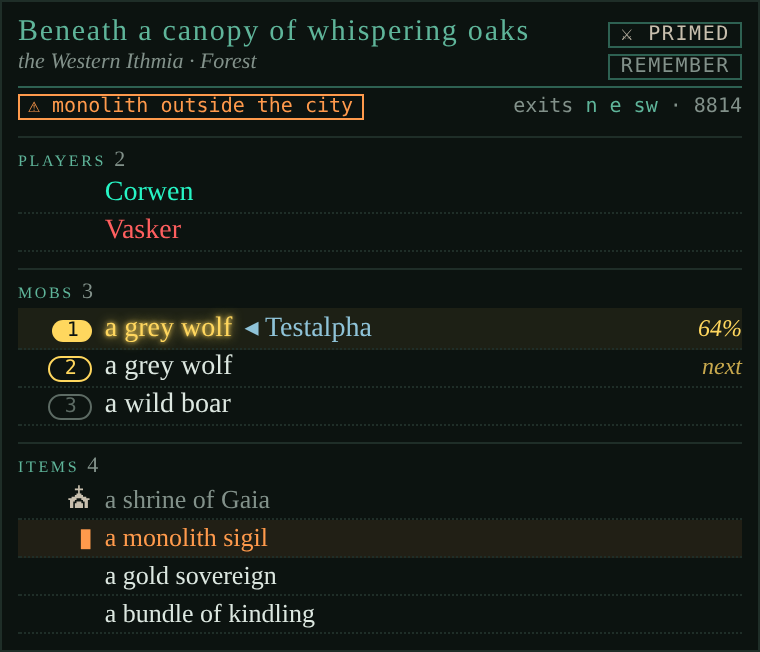

# Room

*The Here tab: the room you're in, who and what is in it, and your target, live.*

<!-- loom:version room -->
*This page describes room 1.1.4.*
<!-- /loom:version -->

## What it is

Room draws a tab called **Here** that replaces Nexus's stock Room tab. It shows the room you stand in, the players and mobs in it, and the items on the floor, and keeps them current as people come and go and mobs die.

Everything comes from the game itself (GMCP), so there's nothing to configure. The only exceptions are a few game lines GMCP doesn't cover (someone flying up or landing, the game confirming a new target), which Room reads as well.

What you see, top to bottom:

- **The room:** its name, area and environment, the room's details as small tags (indoors, a shop, a bank…), the exits and the room number. In the title's top right, under the basher's chip, a small button: **remember** marks the room; once you've moved on it reads **go back** and walks you there (`PATH FIND`), and arriving forgets the mark so you can remember another. In the marked room it reads **remembered**; a click forgets it. `ROOM REMEMBER`, `ROOM BACK` and `ROOM FORGET` do the same from the command line, and the mark survives a reload.
- **The description**, folded to two lines. Click it to unfold it, click again to fold it.
- **Players** here, yourself left out, alphabetical. Hover a name for the player's full title. Your target glows red.
- **Mobs**, one row each in the room's own order: the order the game uses when you target by name, so the next row down is the next mob `kill rat` would hit. Your target glows yellow in place, with its health. Dead ones are greyed out.
- **Items**, duplicates on one row with their count: fixtures first, muted, then the things you can pick up, each in the room's order.

## Commands

<!-- loom:commands room -->
| Command | What it does |
|---|---|
| `ROOM` | the room in a line, and how the description starts |
| `ROOM DESC OPEN\|FOLDED` | show the description in full, or folded to two lines (clicking it flips it too) |
| `ROOM PROBE [ON\|OFF]` | loyals: once a mob has been here 3 s and nothing is hurting you, probe it once, silently, and mark it in Here if it's loyal to someone; loyals are remembered, so they show at once next time (default ON) |
| `ROOM PROBE IGNORE [name]` | places read as owners ("loyal to Qurnok"): mobs loyal to them aren't marked; no name lists them |
| `ROOM PROBE UNIGNORE <name>` | take a name off that list |
| `ROOM PROBE FORGET [CONFIRM]` | forget the loyals remembered from earlier sessions (they're probed again when seen) |
| `ROOM PROBE DEBUG` | the lines the last probe hid, and what ended it |
| `ROOM NOVICE` | the titles that get a green leaf after a player's name (default Uaithne, Ithin, Tuqad) |
| `ROOM NOVICE ADD\|REMOVE <title>` | add or take off a title (one word, as the game shows it) |
| `ROOM NOVICE RESET` | back to the default titles |
| `ROOM REMEMBER` | remember this room (REMEMBER in Here does the same) |
| `ROOM BACK` | walk back to the remembered room with PATH FIND (GO BACK in Here) |
| `ROOM FORGET` | forget the remembered room |
| `ROOM DEBUG` | the last room GMCP payloads, as they came |
| **The Here tab replaces the stock Room tab: create a custom tab named Here, then close the stock one from the layout if you like.** | |
<!-- /loom:commands -->

`ROOM` on its own sums the room up in one line ("Grove of the Ancients (12345), Eleusis: 2 players, 3 mobs, 4 items.") and says how the description starts. `ROOM DESC OPEN` is for players who want the whole description every time; clicking the description still flips it for the moment. `ROOM DEBUG` prints the last room messages the game sent, as they came: paste them with a bug report.

## Setting it up

1. **Import `room.nxs`** (see [Getting started](getting-started.md)).
2. **Create the tab.** Add a custom tab named exactly **`Here`**. If it doesn't appear, reset the UI layout. Its amber icon shows after a page reload. You can then close Nexus's own Room tab from the layout, if you like.
3. **That's it.** Room sends a `LOOK` when it loads, so the tab (and Nexus's map) fills at once, even while you're blind.

It's called Here because Nexus already has a tab called Room, and two tabs with one name don't get along.

## Daily use

Keep Here open beside the main window and glance at it instead of reading the room text.

- **Targeting.** The glow follows whatever changed last: the `tar` variable (your targeting keys and aliases), the game's own target (`ST`, `SETTARGET`), or the line "Your target is now: …". If you target a word, the glow sits on the first living mob whose name holds it, as the game would pick it, so you can see who your next attack lands on. A player whose name matches wins over a mob that merely contains the word.
- **What's next.** Because mobs keep the room's order, one row each, the row under your target is the next one a name would hit after it dies.
- **Who's here.** A player arriving or leaving updates the list at once, flying ones included.
- **Loyals.** Each living mob is probed once, silently (`PROBE` is free), once it has been in the room with you for 3 seconds and you haven't lost health for as long. Loyals are never aggressive, so a mob that attacks you shows itself first, and no probe is out while blows land; rooms you only pass through aren't probed. Each mob is probed once, and the loyals found are remembered from one session to the next: a mob keeps its number in the game for as long as it lives, so a loyal you've met shows its knight the moment you walk in. Room re-checks a remembered loyal after 30 days (it may have changed hands), or at once if the mob under that number has a different name; up to 500 are kept, the least recently seen going first. Mobs loyal to nobody aren't kept: they come back under new numbers. `ROOM PROBE FORGET CONFIRM` forgets them all. One that is someone's loyal gets a knight (♞) on the left and its owner in brackets after its name, (Falau), in the owner's Social group colour when they have one; your own loyals show the knight and their name in green instead. Nothing is printed: the result shows only in Here. Mobs the basher hunts here (ACTIVE in its list for the area) aren't probed: they're ordinary denizens; ignored entries still are. So a loyal that shares its name with an ACTIVE denizen isn't caught, and the basher may target it. Otherwise the basher never queues a loyal (a mob you attack within those 3 seconds, the first time you meet it, hasn't been checked yet). Probes also wait while the basher is fighting. They also wait their turn behind other packages' checks on the same move (Sigils' monolith reading, Patrolling's PLANTS, Harvesting while it harvests the room, Social's QW), so those answers are never hidden; `ROOM PROBE` says whom probes are waiting after. `ROOM PROBE OFF` stops it; `ROOM PROBE` says how many are remembered and lists this session's. Some areas' mobs are loyal to a place named in one word ("He is loyal to Qurnok."), which reads like a player: `ROOM PROBE IGNORE Qurnok` stops marking them (at once, no new probe needed) and forgets the ones remembered, `ROOM PROBE UNIGNORE Qurnok` undoes it, and `ROOM PROBE IGNORE` alone lists the names. City names are left out already.
- **Newbies.** Players carrying a newbie title get a small green leaf after their name; hover it for the title. The titles are Eleusis's (Uaithne, Ithin, Tuqad) unless you change them: `ROOM NOVICE ADD <title>` and `REMOVE <title>` for your city's, `ROOM NOVICE RESET` for the defaults. People remembered under a title you take off are forgotten.

Room also remembers who it has seen with a newbie title, in rooms and in `CWHO`'s citizen list, and forgets them once it sees them without one. The Online and Comms tabs use that list for their own leaves (see below).

## Working with other packages

Room reads nothing from other packages on its own. With others installed, Loom's integrations add to the tab. Each is a link, on as soon as both packages are installed; `LOOM LINKS` lists them, `LOOM LINK <id> OFF` switches one off.

| Link | With | What it does in Here |
| --- | --- | --- |
| `social-room` | social | Players in their social group's colour, the group added to the hover. |
| `patrolling-room` | patrolling | Shrines and totems are coloured by their god's stance (`PATROLLING GODS`): friendly ones green, hostile ones orange with a tinted row and a "⚠ hostile shrine" warning in the header, neutral ones in the plain colour with the shrine icon. |
| `sigils-room` | sigils | Monoliths marked ▮. In a city (Targossas, Cyrene, Hashan, Ashtan, Mhaldor, Eleusis), a room without one gets "⚠ no monolith" in the header, unless you told sigils to ignore it (`SIGILS IGNORE`). A monolith outside a city is flagged too. |
| `magi-room` | [magi](magi.md) | Barnacle encrusted oysters (they drop pearls) and glistening iridescent pearls show with a green name and a green ◉; hover says why. Corpses stay grey; your target's glow still wins. |
| `harvesting-room` | harvesting and patrolling | A small line under the description with the plants this environment should hold: **green** here and stocked, **yellow** here but below your minimum, **red** missing, with a "⚠ N plants missing" warning. It appears once patrolling's plant check has seen the room (with `PATROLLING ON`). Hover a plant for its stock and minimum. |
| `basher-room` | basher | Each living mob's place in the basher's kill order as a numbered badge (filled on your target, outlined in gold on the next one), types the basher ignores in this area dimmed, and the basher's state beside the room name (⚔ PRIMED, RUNNING or FLEEING). |
| `waypoints-room` | [waypoints](waypoints.md) | A room you've saved as a waypoint shows ⚑ and its name as a tag on the exits line, where the details go; hover it for the note. |
| `partycomms-room` | partycomms | Party members' targets: each mob row ends with the names of the members targeting it (◂ Filune · Ojec, small, in blue), from their reports under 30 seconds old; hover says "targeted by …". Not on corpses. |

Room also feeds three links of its own:

| Link | With | What it does |
| --- | --- | --- |
| `room-social` | social | A green leaf in the Online tab on people last seen with a newbie title. |
| `room-comms` | comms | The same leaf on talkers' names in the Comms tab. |
| `room-waypoints` | [waypoints](waypoints.md) | The remembered room (REMEMBER) pinned at the top of the Waypoints tab with how long ago, and GO BACK, FORGET or REMEMBER HERE, as Here's button. |

With a link switched off, Here simply goes without that part; nothing else changes.

## Troubleshooting

- **The tab is empty.** No room has been reported yet: move, or type `LOOK`.
- **A line went missing from the main window.** While a loyal probe's answer comes in, Room hides it, and only it: probes only go out in a calm room, a new room you walk or follow someone into, says, tells and channel lines always show, and a prompt or two ends the hiding. Lines that arrive too soon after a probe to be its answer (a mob attacking the moment you walk in) are never hidden; Room learns how long answers take from your connection. If a later packet still turns out not to be the answer, its lines are shown again just after it, in order but in plain colour. If something still goes missing, type `ROOM PROBE DEBUG` straight after: it lists the lines the last probe hid and what ended it. Report those lines; `ROOM PROBE OFF` stops the probes meanwhile.
- **The tab doesn't appear at all.** The custom tab must be named exactly `Here`. Reset the UI layout if it still doesn't show.
- **Someone is listed who has left (or missing who's there).** A few ways of arriving or leaving send nothing Room can see. The next room you enter puts it right; if you can name the line the game showed, report it so Room learns it.
- **The wrong mob glows.** Room glows the first living mob whose name holds your target word, as the game picks it. If the game hit a different one, report it with `ROOM DEBUG` and the line that named the target.
