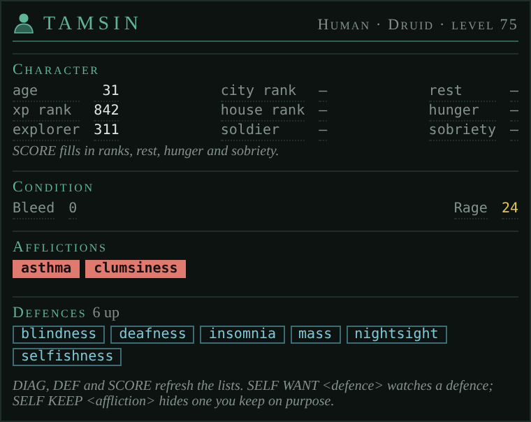

# Self

*The Self tab: your afflictions and defences live, the defences you care about watched, and your character at a glance.*

<!-- loom:version self -->
*This page describes self 0.3.4.*
<!-- /loom:version -->

## What it is

Self draws a tab called **Self** that replaces Nexus's stock character panel. It follows your afflictions and defences as the game reports them, and tells you when a defence you care about is missing.

What you see, top to bottom:

- **Title:** your name, race, class and level; the large number is how many afflictions you have right now.
- **Character:** your XP and explorer ranks (with an arrow when they've moved since you loaded the page: green ▲ better, red ▼ worse), age, city and house ranks, and the longer readings from `SCORE` (rest, hunger, sobriety…), coloured from good to bad.
- **Condition:** your vitals and resistances.
- **Afflictions:** red chips, one per affliction. The row keeps its height when empty, so a new affliction lands in place without pushing the tab around. Afflictions you keep on purpose (deafness, blindness…) are left out.
- **Defences:** the watched ones that are missing first, as red chips; then everything that's up; then, struck through, what you lost in the last two minutes.

Afflictions, defences, vitals and ranks come from the game (GMCP). The rest is read from `SCORE` when you type it.

## Commands

<!-- loom:commands self -->
| Command | What it does |
|---|---|
| `SELF` | name, class, afflictions, and watched defences missing |
| `SELF WANT <defence...>` | watch defences for your current class |
| `SELF UNWANT <defence...>` | stop watching them |
| `SELF WANTS` | the watched defences for this class |
| `SELF KEEP <affliction...>` | hide afflictions you keep on purpose |
| `SELF UNKEEP <affliction...>` | show them again |
| `SELF KEEPS` | the afflictions kept on purpose |
| `SELF NAME [<name>\|CLEAR]` | name in the tab title (default: the game's) |
| `SELF DEBUG` | internal state |
| **Each class, dragonform included, keeps its own watched list; missing ones show in red and losing one is announced.** | |
| **DIAG, DEF and SCORE refresh what the tab shows.** | |
<!-- /loom:commands -->

### Watching defences

`SELF WANT` takes one or more defence names, as `DEF` shows them: `SELF WANT deafness blindness insomnia`. From then on, a missing one shows as a red chip at the head of the Defences row, and losing one is announced in the main window ("[self] lost insomnia!").

Each class keeps its own watched list, and dragonform counts as a class of its own, so switching classes switches lists. `SELF WANTS` shows the list for the class you're in.

### Afflictions kept on purpose

Some afflictions are wanted: deafness and blindness as defences, for instance. `SELF KEEP deafness blindness` leaves them out of the Afflictions row and the count. `SELF KEEPS` lists them; `SELF UNKEEP` brings one back.

### The name

The tab title shows your name as the game sends it. `SELF NAME Neijel` shows another name there (an alt you're testing with, say); `SELF NAME CLEAR` goes back to the game's.

## Setting it up

1. **Import `self.nxs`** (see [Getting started](getting-started.md)).
2. **Create the tab.** Add a custom tab named exactly **`Self`**. If it doesn't appear, reset the UI layout. The bust icon shows after a page reload.
3. **Fill it in once:** type `DIAG`, `DEF` and `SCORE`. After that, afflictions and defences keep themselves current; type `SCORE` again whenever you want the Character readings refreshed.
4. **Pick the defences to watch** for each class you play: `SELF WANT …`.

If you used the older self package, its watched list, kept afflictions and name carry over the first time Self loads.

## Daily use

- **In a fight, glance at the Afflictions row.** Red chips are what you need cured.
- **A yellow "diag" chip** appears when a venom's effects are unknown ("You are confused as to the effects of the venom."). Type `DIAG`; the chip goes when the game lists your afflictions.
- **Red chips under Defences** are watched defences you don't have up. A struck-through chip is one you just lost: you'll know it was stripped rather than never raised.
- **Ranks.** An explorer rank getting worse while you play means someone explored past you; with the ledger installed, Self adds a reminder (see below).

## Working with other packages

Self works on its own. With others installed, Loom's integrations add to it. Each is a link, on as soon as both packages are installed; `LOOM LINKS` lists them, `LOOM LINK <id> OFF` switches one off.

| Link | With | What it does |
| --- | --- | --- |
| `defcon-self` | defcon | The defences DEFCON keeps up at its current level are watched too, as their own layer: missing ones show as **amber** chips (yours from `SELF WANT` stay red), and the Defences heading names the level ("Defences · DEFCON 3 · 18 up"). Losing one of these isn't announced; DEFCON already puts it back. They never enter your `SELF WANT` list. |
| `self-ledger` | ledger | When your explorer rank gets worse while you play, the ledger gets "Explore a new area (explorer rank 120 → 125)". It stays until you mark it done or drop it; the next drop after that brings a new one. |

## Troubleshooting

- **"afflictions not reported yet" / "defences not reported yet".** The game hasn't sent them since the page loaded. `DIAG` and `DEF` fill them in.
- **A watched defence is red but you have it up.** The name must match what `DEF` lists, not the command that raises it. `SELF WANTS` shows what Self is looking for.
- **The Character readings are old.** They're only as fresh as your last `SCORE`. Ranks and age update on their own.
