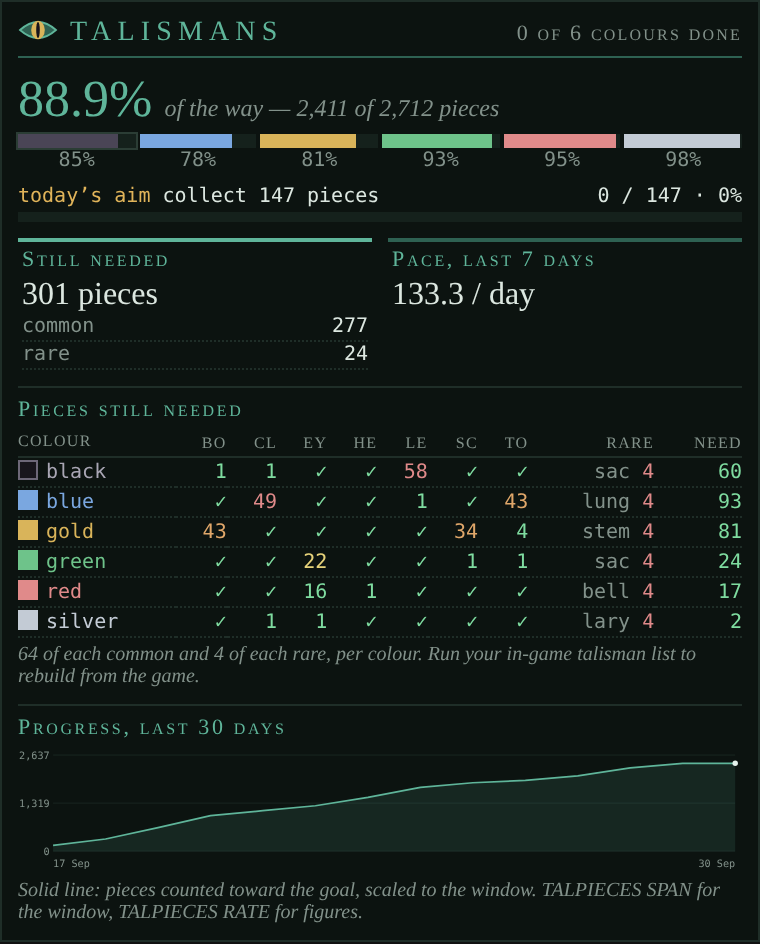

# TalPieces

*Dragon talisman pieces counted toward the Elder Dragon set: what you have, what you still need, and when you'll finish at your pace.*

<!-- loom:version talpieces -->
*This page describes talpieces 1.2.0.*
<!-- /loom:version -->

## What it is

TalPieces keeps count of your dragon talisman pieces as you find them, trade them and list them, and shows your progress toward the full set in the **Talismans** tab:

- **The headline**: how much of the set you hold, common and rare.
- **A goal bar**, when you set a goal of your own or have today's aim from the ledger.
- **A graph** of your progress over the last 30 days (or any span you pick), and your pace over the last seven days with a projected finish date.
- **A grid of what's still needed**, by colour (black, blue, gold, green, red, silver) and piece type, coloured from green (nearly there) to red (far off).

The set needs, per colour, 64 of each of the seven common pieces and 4 of the rare one. Higher-level pieces count for more: a level-n piece is worth 2^(n-1) level-1 pieces, so a level-3 claw counts as 4. Extra pieces beyond what a type needs don't count toward the goal (100 black claws still count as 64).

It counts from the game's lines:

- "You have found a Black Dragon claw (level 1) talisman piece!"
- pieces traded to you, and pieces you trade away;
- your talisman listing, which rebuilds the whole count from what the game shows.

## Commands

<!-- loom:commands talpieces -->
| Command | What it does |
|---|---|
| `TALPIECES` | progress, history and settings |
| `TALPIECES NEED` | pieces still needed, per colour and type |
| `TALPIECES RATE` | pieces per day and a projected finish |
| `TALPIECES GOAL <n\|OFF>` | a goal of your own: collect n pieces from now, shown in place of the daily aim |
| `TALPIECES MARK` | store a history point now |
| `TALPIECES GRAPH [ON\|OFF]` | show or hide the graph in the Talismans tab |
| `TALPIECES GRAPH <40-400>` | graph height (default 110, lower is flatter) |
| `TALPIECES SPAN <7-365\|ALL>` | days the graph shows (default 30); ALL is the whole history against the full set |
| `TALPIECES SEED <YYYY-MM-DD> [c] [r]` | backdate a starting point: common and rare held then |
| `TALPIECES CSV` | history as CSV lines (most recent 300) |
| `TALPIECES COMBINE ON\|OFF` | queue TALISMAN COMBINE for each row when you list |
| `TALPIECES WIPE PIECES\|HISTORY CONFIRM` | clear the tracked pieces / the graph history |
| `TALPIECES RESET / DEBUG` | reload from saved variables / internal state |
| **Pieces are counted as you find, trade and list them; list yours in game to rebuild the count.** | |
<!-- /loom:commands -->

`TALPIECES NEED` prints the needed grid in the main window; `TALPIECES RATE` your pace and projected finish. `TALPIECES MARK` stores a history point now.

### Starting from where you are

The count is only as good as what TalPieces has seen. **List your pieces in game once** after installing: the listing rebuilds the count from scratch (across every page of it). Do it again whenever the count looks off.

To give the graph a past, `TALPIECES SEED 2026-09-01 120 4` backdates a starting point: on 1 September you held 120 common and 4 rare (counted as the goal counts them).

### Combining

With `TALPIECES COMBINE ON`, each piece row of your listing queues `TALISMAN COMBINE` for it, so listing also combines what can be combined. It's on by default; `TALPIECES COMBINE OFF` leaves combining to you.

### A goal of your own

Against the whole set, a day's pieces barely show. `TALPIECES GOAL 50` sets a smaller goal: collect 50 pieces from now, counted as the set counts them (spares beyond what a type needs don't count). The tab shows it as a bar of its own under the headline, with the count so far, and `TALPIECES` and `TALPIECES GOAL` tell you where you stand. Reaching it gives a lime notice; it stays shown as reached until you set the next one or clear it with `TALPIECES GOAL OFF`. While set, it takes the place of the daily aim on that bar (the aim still stands in the ledger).

### Housekeeping

`TALPIECES GRAPH OFF` hides the graph, `TALPIECES GRAPH 80` makes it flatter. The graph shows the last 30 days, scaled to what moved in them; `TALPIECES SPAN 90` widens the window, and `TALPIECES SPAN ALL` shows the whole history against the full set. The span only changes the view: the history behind it, and `TALPIECES RATE`, are untouched. `TALPIECES CSV` prints the history (most recent 300 points) as CSV lines. History keeps full detail for 30 days, then one point per day.

## Setting it up

1. **Import `talpieces.nxs`** (see [Getting started](getting-started.md)).
2. **Create the tab.** Add a custom tab named exactly **`Talismans`**. If it doesn't appear, reset the UI layout. Its icon shows after a page reload.
3. **List your pieces in game** once, so the count starts right.

If you used the older talismans package, its data moves over the first time TalPieces loads, and it uses the same Talismans tab. Its TalGraph tab is gone: close it.

## Daily use

Hunt as usual: found pieces are counted as they drop. After trading, the count follows on its own. Once in a while, list your pieces to resync, and look at the grid to see which colour and type to trade for.

## Working with other packages

TalPieces reads nothing from other packages. With **ledger** installed, it adds reminders (link `talpieces-ledger`):

- **"Black talisman set complete: turn it in"**, when a colour has everything it needs;
- **"Spare talisman pieces to trade (N): …"**, once you hold 16 or more pieces beyond what the set needs, listing them; it goes when you're back below 8, so one extra piece doesn't bring it back and forth.

Like every ledger reminder from another package, it goes by itself when its condition clears. `LOOM LINK talpieces-ledger OFF` stops them.

A second link, `talpieces-aim-ledger`, sets a **daily aim**: "Collect 21 talisman pieces", your pace over the last 7 days (the tab's *Pace, last 7 days*) plus 10%, counted from the day's first update. Reaching it gives a lime notice and the item goes until the next day's. The goal bar in the Talismans tab shows the same aim and how many you've collected, unless you set a goal of your own or drop the aim from the ledger. `LOOM LINK talpieces-aim-ledger OFF` stops it and leaves the set and spares reminders alone.

## Troubleshooting

- **The count is wrong.** List your pieces in game: the listing replaces the count with what the game shows.
- **"not enough movement yet to project a finish".** It needs progress in the history: the last 7 days, or all of it when the history is shorter. `TALPIECES SEED` gives it a past.
- **`TALPIECES WIPE PIECES`** clears the count; **`WIPE HISTORY`** clears the graph. There's no undo for either.
