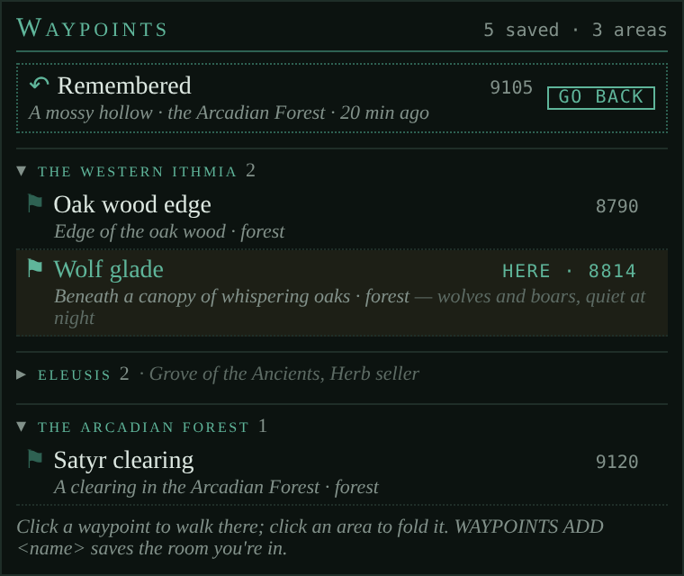

# Waypoints

*Rooms you save by name, listed by area in a tab; one click walks you there.*

<!-- loom:version waypoints -->
*This page describes waypoints 0.1.1.*
<!-- /loom:version -->

## What it is

Waypoints keeps the rooms you want to come back to (a hunting spot, a shop, your guild hall), each under a name you give it and with an optional note, with no limit on how many. They're listed in a custom tab named **Waypoints**, grouped by area, and a click on one walks you there with the game's `PATH FIND <number>`.

- **By area.** The area you're in comes first, the others follow by name. Click an area's header to fold it: a folded area keeps its count and lists its waypoints' names on the header line. Folding is remembered.
- **Two lines a row.** The flag and the name you gave it, with the room number on the right; under it, the game's room name, its environment and your note.
- **Where you are.** A waypoint you're standing in is highlighted and reads `HERE`.
- **Adding and removing.** `⊕ ADD HERE` on the title line, shown when the room you're in isn't saved yet, saves it under the room's own title (with its number added if another waypoint has that name); `WAYPOINTS RENAME` gives it your own. Hover a row for its `×`, which removes it at once.

With **room** installed, its REMEMBER is pinned at the top as a shortcut waypoint: the remembered room, its area and how long ago, with **GO BACK** (or **FORGET** while you're in it). With nothing remembered, the box offers **REMEMBER HERE**. In Here, a room you've saved shows its name as a ⚑ tag on the exits line, with the note on hover.

Walking is the game's own `PATH FIND`: Waypoints sends it once per click and does nothing else.

## Commands

<!-- loom:commands waypoints -->
| Command | What it does |
|---|---|
| `WAYPOINTS` | status: how many saved, and whether this room is one |
| `WAYPOINTS LIST` | every waypoint, by area |
| `WAYPOINTS ADD [name]` | save the room you're in; no name: the room's own title (as ADD HERE in the tab) |
| `WAYPOINTS REMOVE <name\|number>` | forget one (also the × on its row in the tab) |
| `WAYPOINTS RENAME <name\|number> <new name>` | give it another name |
| `WAYPOINTS NOTE <name\|number> <text>` | a note under it in the tab; no text clears it |
| `WAYPOINTS GO <name\|number>` | walk there (PATH FIND), as a click in the tab |
| `WAYPOINTS RESET` | reload saved waypoints, redraw the tab |
| `WAYPOINTS DEBUG` | internal state |
| **The tab is a custom tab named Waypoints. Click an area to fold it.** | |
<!-- /loom:commands -->

Names can have spaces: `WAYPOINTS RENAME rat spot Big rat spot` renames "Rat spot" to "Big rat spot", and `WAYPOINTS NOTE rat spot quiet at night` puts that note under it. A waypoint can also be named by its room number: `WAYPOINTS GO 5001`. Two waypoints can't share a name, and a room is saved once.

## Setting it up

1. **Import `waypoints.nxs`** (see [Getting started](getting-started.md)).
2. **Create a custom tab named `Waypoints`** (exactly that name); it fills in at once.
3. Walk to a room you want to keep and click **`⊕ ADD HERE`** in the tab (or `WAYPOINTS ADD <name>` to name it as you save it).

## Daily use

Click a waypoint to go there; `PATH FIND` walks you, and the game stops it if something's in the way. Fold the areas you don't use often. Add a note to anything you'd otherwise forget about a place: who buys what, which mobs, when it's quiet.

## Working with other packages

Waypoints reads nothing from other packages. With **room** installed, Loom's integrations join the two. Each is a link, on as soon as both packages are installed; `LOOM LINKS` lists them, `LOOM LINK <id> OFF` switches one off.

| Link | With | What it does |
| --- | --- | --- |
| `waypoints-room` | room | A saved room's name as a ⚑ tag on Here's exits line, the note on hover. |
| `room-waypoints` | room | Here's remembered room pinned at the top of Waypoints, with GO BACK, FORGET or REMEMBER HERE (the same as Here's button). |

## Troubleshooting

- **The tab stays empty.** Check the custom tab is named exactly `Waypoints`, then `WAYPOINTS RESET`.
- **A click doesn't walk.** `PATH FIND` needs a route the game knows; try `PATH FIND <number>` yourself to see the game's answer. Nothing walks while Loom is paused (`LOOM PAUSE ON`).
